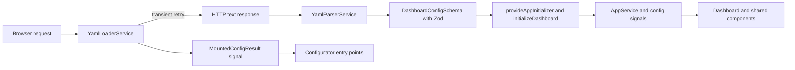
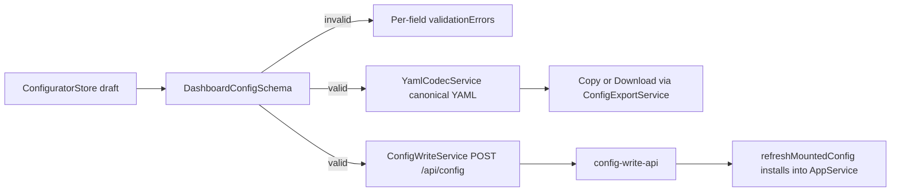
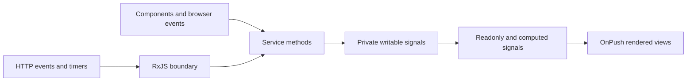
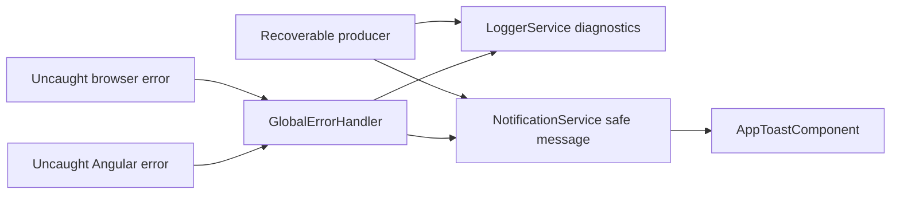

# Mando Architecture

Mando is a client-rendered Angular dashboard configured from one YAML file. It renders two routes:
the dashboard view, and a browser-based configurator that edits the same configuration. The
application validates the YAML, installs the resulting configuration into signal-based state, and
renders the active route. The production container serves the compiled app and the mounted YAML
through nginx, and also runs an optional write sidecar (`server/`) that the configurator's "Save"
action posts to, gated by a shared-secret token.

This guide describes the current implementation. Use it to locate ownership, preserve dependency
direction, and choose the smallest verification scope for a change.

## Read This First

For a first contribution:

1. Read [README.md](README.md) for setup and user-facing configuration.
2. Read [AGENTS.md](AGENTS.md) for project coding, state, accessibility, and error conventions.
3. For any non-trivial change, read the applicable capability spec in the separate
   [getmando-specs](https://github.com/rackandhost/getmando-specs) repository (see Repository
   Shape below).
4. Start the app with `npm install` and `npm start`. Use `npm run dev` to also run the write
   sidecar (needed only for the configurator's Save action).
5. Follow startup from [src/main.ts](src/main.ts) to
   [src/app/app.config.ts](src/app/app.config.ts), then to
   [dashboard.initializer.ts](src/app/core/initializers/dashboard.initializer.ts).
6. For UI work, begin at
   [dashboard.component.ts](src/app/views/dashboard/dashboard.component.ts) or
   [configurator-page.component.ts](src/app/features/configurator/configurator-page.component.ts)
   and move into the relevant shared component.
7. Run `npm test`, `npm run lint`, `npm run format:check`, and `npm run build` before review. For
   sidecar changes also run `npm --prefix server run typecheck` and `npm --prefix server test`.

## Stack

Versions below are the ranges declared in [package.json](package.json) and
[server/package.json](server/package.json).

| Technology              | Current version | Role                                                                 |
| ----------------------- | --------------- | -------------------------------------------------------------------- |
| Angular                 | 21.2            | Standalone application, DI, signals, HTTP, routing, and build        |
| TypeScript              | 5.9             | Strictly typed application, sidecar, and tests                       |
| RxJS                    | 7.8             | HTTP startup flow and other genuine asynchronous boundaries          |
| Vitest                  | 4.0             | Unit and component tests, in the app and the sidecar                 |
| Angular Testing Library | 19.1            | User-oriented component rendering and interaction tests              |
| Tailwind CSS            | 4.1             | Utility-first styling over the per-theme CSS tokens                  |
| Zod                     | 4.3             | Runtime dashboard schema and inferred types, shared with the sidecar |
| js-yaml                 | 4.3             | YAML text parsing and serialization, shared with the sidecar         |
| Fastify                 | 5.2             | `server/` config-write sidecar HTTP server                           |
| Angular CLI / build     | 21.2            | Development server, production bundle, and test integration          |

Supporting tools include ESLint 9, Prettier 3, axe-core 4, PostCSS 8, esbuild (sidecar bundling),
and npm 11. CI uses Node 22; the Docker build stages use `node:20-alpine`, and the production image
adds the Node runtime so the sidecar can run beside nginx.

## Repository Shape

```text
src/
  main.ts                 browser bootstrap
  app/
    app.config.ts         root providers and the single startup initializer
    app.ts, app.html      root composition: app shell, routed outlet, global toast outlet
    app.routes.ts         dashboard route plus the lazy configurator route
    core/
      errors/             last-resort global error handling
      initializers/       startup orchestration
      models/             Zod schemas, inferred types, defaults, shared validation
      scroll/             ScrollStateService, its pure core and the browser metrics token
      services/           configuration, state, domain operations, and diagnostics
      themes/             the theme registry: the only list of themes
    features/
      configurator/       browser-based YAML editor, loaded as a lazy route; chrome/ holds one page arrangement per layout
    shared/
      components/         reusable or feature-level presentation components; rail/ is the vertical layout's sidebar, theme-picker/ the theme dialog
      directives/         sticky dock, rail stick, chip autocenter and horizontal-nav directives
    views/dashboard/      route component that switches between horizontal/ and vertical/ page compositions
  styles/                 design tokens, one stylesheet per theme (themes/), glass surface recipes, base layer, self-hosted fonts
  testing/                shared test helpers and tooling regression tests
public/
  config/                 runtime YAML and user-facing example
  img/                    static backgrounds and branding
server/                   config-write-api sidecar (own package.json and tests)
  src/
    index.ts              environment parsing, status poller start, listen
    app.ts                Fastify instance: authenticated POST /api/config, public GET /api/status and GET /api/capabilities
    write-config.ts       atomic file write with .bak rotation
    status-poller.ts      periodic checks of healthCheck apps, in-memory status cache
    status-checker.ts     one reachability check (any HTTP response is up)
```

Root build and delivery files are [angular.json](angular.json), [proxy.conf.json](proxy.conf.json),
[Dockerfile](Dockerfile), [entrypoint.sh](entrypoint.sh), and [nginx.conf](nginx.conf). Kubernetes
deployment manifests (the Kustomize base) live in [deploy/kubernetes](deploy/kubernetes). CI
workflows live in [.github/workflows](.github/workflows); the Forgejo-only beta workflow lives in
[.forgejo/workflows](.forgejo/workflows).

The project's specifications live in a separate repository,
[getmando-specs](https://github.com/rackandhost/getmando-specs) (`openspec/` layout: `specs/` for
shipped capabilities, `changes/` for active proposals), normally opened beside this repository
through the `getmando.code-workspace` multi-root workspace.

### Dependency Rules

- `core/` owns schemas, state, startup, infrastructure adapters, and cross-cutting services. It
  must not depend on views, features, or shared components.
- `shared/components/` may consume core services and models. Components expose UI contracts with
  `input()` and `output()` when parent-child communication is appropriate.
- `views/` and `features/` compose shared components and connect them to core state. Page-specific
  effects, such as selecting the configured background for the resolved theme, stay at this
  boundary. Nothing depends back into a view or a feature.
- Feature-scoped services are provided at the route, not at root. `ConfiguratorStore` is registered
  in `CONFIGURATOR_ROUTES` and lives only while the `configure` route is active.
- `server/` is a separate npm package. It imports exactly one file from the app,
  [dashboard.models.ts](src/app/core/models/dashboard.models.ts), to share the Zod schema, and
  nothing else. Keep that file free of Angular and browser-only imports.
- `app.ts` is composition only. It places `AppShellComponent` and the routed outlet beside the
  global `AppToastComponent`; it does not own feature state.
- Tests remain beside the code they protect. Cross-cutting helpers belong in `src/testing/`.
- `public/` is copied as static output. Do not import runtime configuration into the bundle.

### Routing

[app.routes.ts](src/app/app.routes.ts) declares two routes. `''` renders `DashboardComponent`,
which draws the dashboard of the active layout (see Layouts). `configure` lazy-loads
`CONFIGURATOR_ROUTES`, which provides `ConfiguratorStore` and renders `ConfiguratorPageComponent`.
[AppShellComponent](src/app/shared/components/app-shell/app-shell.component.ts) is the page
container shared by both routes and follows the layout: a centred column (max 1360 px) followed by
the footer bar for `horizontal`, full width with no footer bar for `vertical` (the rail carries the
version and credit). The window scrolls; the routed page renders its own header or rail and sticky
chrome. The link between the dashboard and the configurator comes from `ConfiguratorNavService`,
which derives it from the active URL and is shared by every header and rail; each page decides how
its chrome compacts (see Scroll State and Sticky Chrome).

## Startup and Configuration

The browser requests `/config/dashboard.yaml`. Development serves the copy under `public/config/`;
the production nginx location aliases that URL to `/app/config/dashboard.yaml`, normally a mounted
file.



The exact ownership sequence is:

1. `bootstrapApplication(App, appConfig)` starts the standalone root.
2. `appConfig` registers HTTP, the router, browser global error listeners, the custom error
   handler, and `provideAppInitializer(initializeDashboard)`.
3. Angular subscribes to the initializer's `Observable<void>` and waits for completion before
   bootstrap completes.
4. `YamlLoaderService` fetches YAML text, then `YamlParserService` uses js-yaml and
   `DashboardConfigSchema.safeParse` to produce a typed `DashboardConfig`.
5. `loadDashboardConfig` maps the outcome to a loaded config or a cloned default, and
   `initializeDashboard` calls `AppService.initializeConfig` exactly once with the result.
6. Core computed signals derive metadata, settings, categories, bookmarks, and filtered apps for
   the view tree.

`AppService` has no constructor and performs no I/O. The initializer is the only installation
owner; services expose state and transformations rather than independently starting configuration
loads.

### Mounted Configuration Outcomes

`YamlLoaderService` caches the single startup request and keeps its outcome as a
`MountedConfigResult`, exposed as the `mountedConfigResult` signal so the configurator can react to
it without re-fetching:

| Outcome       | Cause                               | Startup effect                                |
| ------------- | ----------------------------------- | --------------------------------------------- |
| `valid`       | file parsed and passed the schema   | dashboard uses the mounted configuration      |
| `missing`     | HTTP 404 — no file mounted          | first run: dashboard uses defaults, silently  |
| `unavailable` | other HTTP failure, after retries   | dashboard uses defaults and one warning toast |
| `invalid`     | js-yaml or Zod rejected the content | dashboard uses defaults and one warning toast |

### Retry and Fallback Ownership

`YamlLoaderService` retries only `HttpErrorResponse` statuses `0`, `408`, `429`, and `500` through
`599`. Its three retries wait 250 ms, 500 ms, and 1000 ms. Other HTTP failures and deterministic
YAML parse or Zod schema failures are not retried.

After a non-retryable failure the loader records the `MountedConfigResult`, and `loadDashboardConfig`
returns a cloned default configuration. Only `unavailable` and `invalid` log a warning and emit one
warning toast; `missing` is silent, because an unmounted file is the expected first-run state. The
initializer's own catch is a final defensive boundary for errors that escape the loader: it logs
once, emits one startup error, installs `DEFAULT_DASHBOARD_CONFIG`, and completes. Producers must
not duplicate notifications already owned by a fallback boundary.

`DEFAULT_DASHBOARD_CONFIG` is intentionally not a schema-valid document — it has no categories or
applications. The virtual `apps` category is supplied by `CategoryService` at render time;
`apps`, `bookmarks`, and `favorites` are reserved category IDs that `DashboardConfigSchema` rejects
in user configuration. The schema and defaults are in
[dashboard.models.ts](src/app/core/models/dashboard.models.ts), which also holds the
cross-collection rules (IDs unique across categories, applications, and bookmarks; every
application `category` must match a declared category ID). Use
[dashboard.example.yaml](public/config/dashboard.example.yaml) as the user-facing configuration
example; keep it aligned when changing the schema.

## Configuration Editing

The `configure` route renders a browser-only editor that produces the same YAML the loader
consumes. It changes nothing on its own; the only write path is the explicit Save action.

`ConfiguratorStore` (provided per route) holds a `ConfiguratorDraft` signal plus `isDirty` and
`validationErrors`. Three entry points seed the draft:

- **Start empty** — a blank draft.
- **Load mounted YAML** — offered only when `mountedConfigResult()` is `valid`; clones the running
  configuration into the draft.
- **Import local YAML** — parses a picked file through `YamlCodecService`; failures populate
  `validationErrors` instead of replacing the draft.

Edits go through typed store methods (`updateMetadata`, `addCategory`, `updateApplication`,
`moveBookmark`, and so on). `toDashboardConfig()` runs the shared `DashboardConfigSchema` and
returns `undefined` while the draft is invalid, publishing per-field errors. Because the schema
requires at least one category and one application, an empty draft cannot be exported or saved.



Output paths:

- **Copy / Download** — `serializeExportableDraft()` serializes only a schema-valid config to
  canonical YAML through `YamlCodecService`; `ConfigExportService` performs the clipboard or
  blob-download effect and its notification.
- **Save to server** — posts the validated config to the write sidecar via `ConfigWriteService`. A
  missing token opens an inline prompt; the token is kept in `localStorage` under
  `config-write-token` and cleared on a `401`. On success the store is marked clean and
  `YamlLoaderService.refreshMountedConfig()` re-fetches the YAML and installs it into live
  `AppService` state, so the dashboard reflects the save without a reload. The editor asks
  `ConfigWriteService.isWriteEnabled()` (`GET /api/capabilities`) and disables Save, with the reason
  next to it, only when the sidecar answers `{write: false}`; an unreachable sidecar or an
  unexpected answer leaves Save available, and Save then reports the real error.

The editor's arrangement follows the *active* configuration's `settings.layout`, never the draft's:
choosing a layout in the Layout control only edits the draft. After a successful Save that changes
the layout, the page redraws inside the other chrome and `restorePlace` puts the user back at the
same section and offset (or at the end of the page) and refocuses Save. Because the Items per row
field is disabled with the vertical layout, `ConfiguratorStore.updateSettings` replaces an invalid
value with the default when `vertical` is chosen and raises an `info` notification, so the draft
can still validate.

## Config Write Sidecar

`server/` is a standalone Fastify service, bundled into the production image and started beside
nginx. It exposes three routes; `POST /api/config` writes the configuration:

1. An `onRequest` hook compares the `x-config-token` header to `CONFIG_WRITE_TOKEN` before Fastify
   parses the body; a mismatch returns `401` and the payload is never read.
2. The body is validated with the shared `DashboardConfigSchema`. Failures return
   `400 {status: 'invalid', errors}` in the same `ParseError` shape the browser uses; an oversized
   body returns `413`.
3. A valid config is normalized with `omitBlankBackgroundImages` (shared with the browser export so
   Save and Copy/Download never disagree) and dumped to YAML.
4. `writeConfigAtomically` writes `dashboard.yaml.tmp`, fsyncs it, copies any existing file to
   `dashboard.yaml.bak`, then renames the temp file into place. A failure at any step leaves the
   live file intact.

[index.ts](server/src/index.ts) reads `CONFIG_WRITE_TOKEN` (empty when unset, so the hook rejects
every write with `401` while the process still starts), `CONFIG_PATH` (default
`/app/config/dashboard.yaml`), `PORT` (default 3000), `HOST`, and `STATUS_CHECK_INTERVAL_MS`.
In the container, nginx proxies `/api/` to `127.0.0.1:3000`, and [entrypoint.sh](entrypoint.sh)
starts the sidecar in the background then execs nginx, with `tini` as PID 1. Locally, `npm run dev`
([scripts/dev.sh](scripts/dev.sh)) runs both processes and [proxy.conf.json](proxy.conf.json)
forwards `/api` from the dev server to the sidecar.

Without `CONFIG_WRITE_TOKEN` the editor disables Save (the sidecar's `GET /api/capabilities` reports
`{write: false}`, a boolean that never carries the token) while the dashboard still serves normally,
Copy/Download remain available, and status checks keep working. With the config mounted read-only
Save stays enabled and fails when used.

## App Status Checks

Applications with `healthCheck: true` show a status badge. The check runs in the sidecar, so it
reflects reachability from the server rather than the viewer's browser and is not subject to CORS
or mixed content.

- [status-poller.ts](server/src/status-poller.ts) runs once at startup and then every
  `STATUS_CHECK_INTERVAL_MS` (default 60000, clamped between 1 second and Node's maximum timer
  delay). Each cycle re-reads `CONFIG_PATH`, so edits made outside the write API are picked up,
  checks every `healthCheck: true` application in parallel, and caches `{status, checkedAt}` per
  application id in memory. A missing or invalid file keeps the previous cache, entries for
  applications no longer monitored are pruned, and a cycle that outlasts the interval makes the
  next tick skip instead of overlapping.
- [status-checker.ts](server/src/status-checker.ts) treats any HTTP response, whatever its status
  code, as `up`. A network failure, or a response that does not start within the 5 second total
  deadline, is `down`. TLS verification is disabled for this request only.
- `GET /api/status` is unauthenticated and read-only and returns
  `{intervalMs, apps: {id: {status, checkedAt}}}`, with no URLs or other configuration. It works
  without `CONFIG_WRITE_TOKEN`, and nginx forwards it with the rest of `/api/`.
- `AppStatusService` polls that endpoint only while the loaded configuration has at least one
  monitored application, starting and stopping reactively. It learns the cadence from `intervalMs`
  (floor of 5 seconds), retries a failed poll every 15 seconds up to four times, then stops until
  the page reloads, keeping the last known statuses.
- `AppCardComponent` renders the badge when `healthCheck` is true and a status exists. The badge is
  decorative: the state is part of the card's accessible name, and a check mark versus a cross keeps
  it distinguishable without colour.

## State and Interaction Flow

Synchronous application and UI state uses writable private signals, readonly public signals, and
`computed()` derivations. `AppService` is the facade for configuration installation, search query,
category selection, app lookup, and the combined/filtered application list. Focused services retain
ownership of their own state.



Examples:

- `AppFinderComponent` keeps input and selected search engine UI state locally. Application search
  calls `AppService.setSearchQuery`, which delegates to `SearchService`.
- `AppCategoriesComponent` delegates selection through `AppService.setSelectedCategory`.
- `AppService.filteredApps` combines configuration, bookmarks, search, and category signals.
- `NotificationService` owns a bounded signal list and timer-backed dismissal.
- `ThemeService` owns the device's stored theme choice, the committed theme, the transient preview and
  `<html data-theme>` (see Theme Resolution).
- `ConfiguratorStore` owns the editor draft, dirty flag, and validation errors for the lifetime of
  the `configure` route.
- `AppStatusService` owns the statuses signal keyed by application id and its polling lifecycle (see
  App Status Checks).
- `ScrollStateService` owns one scroll state (`static`, `top` or `scrolled`) per sticky chrome (see
  Scroll State and Sticky Chrome).

Use RxJS for HTTP, browser event streams, debounce, or multi-source asynchronous orchestration. Do
not introduce `BehaviorSubject` as a general store or wrap synchronous signal state in observables.

## Theme Resolution

[theme.registry.ts](src/app/core/themes/theme.registry.ts) is the only list of themes (`THEMES`): id,
name, description, the background slot the theme uses (`light` or `dark`) and the swatch the picker
draws. `ThemeId`, the `settings.theme` schema (`THEME_SETTINGS`, which adds `auto`: a value of the
setting, not a theme), the picker, the editor's Default theme control and the contrast audit are all
derived from it. A theme is the stylesheet `styles/themes/<id>.css`, selected by
`<html data-theme="<id>">`; the default theme (`dark`) also answers to a bare `:root`.

`ThemeService` has three layers, each a computed over the one before:

1. `preference`: a persisted value under `dashboard-theme` wins over configuration. It is a
   registered id, or `auto` as earlier versions wrote it; any other stored value is ignored as if
   absent. Without one, the YAML `settings.theme` governs and may change when configuration arrives.
2. `committed`: the preference resolved to a theme. `auto` resolves through the system
   `prefers-color-scheme: light` media query and follows system changes live.
3. `theme`: what is shown, the transient preview if there is one, else `committed`. `info()` is its
   registry entry.

`select(id)` stores a choice (which ends `auto` on that device) and drops the preview. `preview` and
`cancelPreview` change only what is shown and never touch storage. `clearPreference()` removes the
stored choice so the configured theme governs again: the configurator's Save calls it when the saved
`settings.theme` differs from the one in force, before refreshing the live configuration, so the
saved theme shows at once; saving anything else keeps the device's choice. One effect writes
`data-theme` on `<html>`, the only DOM write (there is no `dark` class). The dashboard picks
`lightBackgroundImage` or `darkBackgroundImage` from `info().background`.

First paint: an inline script in `index.html` copies the stored value to `data-theme` before the
stylesheet paints, interpreting only `auto`. An unknown value matches no theme selector, so the
default theme paints until `ThemeService` rewrites the attribute.

The picker is [ThemePickerComponent](src/app/shared/components/theme-picker/theme-picker.component.ts):
a native `<dialog>` opened with `showModal()`, so the browser supplies the focus trap and the inert page
and the top layer lifts it above the glass chrome that would clip a fixed overlay. Highlighting a row
other than the committed theme previews it; Enter or a click commits (`select`); `Esc`, Close and the
backdrop restore the committed theme. It closes if its button is hidden (a layout change). The swatch
it draws, `ThemePreviewComponent`, lives in `shared/` and is also used by the editor's Default theme
control, because `shared/` must not import from `features/`.

Storage failures are non-fatal. A read failure logs and warns, then falls back to configured theme.
A write or clear failure logs and warns, while the selection still applies for the current session.
The YAML setting itself is not written to browser storage.

## Layouts

`settings.layout` (`horizontal`, the default, or `vertical`) arranges both routes.
`SettingsService.layout` is the only read point: a computed over the active configuration, so a
file without the key renders `horizontal`. The two layouts differ in DOM order, landmarks and
sticky model, so each is its own component rather than one template restyled by CSS.

- **Dashboard.** `DashboardComponent` is a switch over `DashboardHorizontalComponent` (header, clock,
  search and categories in a sticky dock) and `DashboardVerticalComponent` (rail beside the app
  grid). Both read the same services; only structure and presentation differ.
- **Rail.** [rail/](src/app/shared/components/rail) holds `AppRailComponent` (the frame) and its brand,
  actions, clock and categories blocks; `AppFinderComponent` has a `rail` variant. From 1024 px the
  rail is a sticky 300 px column; below it, a bar at the top of the page. The DOM order is the visual
  order at every width: the actions appear twice and the one that is not drawn is `display: none`.
- **Compact rail.** [RailStickDirective](src/app/shared/directives/rail-stick.directive.ts) applies
  below 1024 px on a viewport at least 500 px tall. It measures how far the bar may scroll before it
  sticks (`--rail-stick`), so only the block marked `data-rail-anchor` (the search) and what follows
  stay on screen, and sets the document's `scroll-padding-top` to what remains visible so a focused
  control is not left underneath. The arithmetic is in the pure [rail-stick.ts](src/app/shared/directives/rail-stick.ts).
- **Configurator.** The page keeps the store, the scroll-spy and every handler, and the form body is
  shared. Only the arrangement around it changes: `ConfiguratorHorizontalChromeComponent` (sticky
  header, side navigation, chip bar up to 900 px) or `ConfiguratorVerticalChromeComponent` (the rail
  with the section navigation, a chip bar when compact). Each provides itself under the abstract
  `ConfiguratorChrome` (`narrow()`, `stackHeight()`, `sectionMargin()`), which the page finds with
  `viewChild`, so section scrolling and the spy do not know which layout is drawn.
- **Layout control.** `LayoutPickerComponent` is a disclosure holding a radio group whose options
  carry a `LayoutThumbnailComponent` schematic.

Only the horizontal layout registers chromes with `ScrollStateService`; the vertical layout has no
compacting dock.

## Design Tokens and Glass Surfaces

The look comes from the CSS under [src/styles](src/styles), imported by `styles.css`:

- [tokens.css](src/styles/tokens.css) keeps what no theme changes (a non-colour constant) and the
  `@theme inline` mapping that makes the Tailwind utilities (`bg-accent`, `text-muted`, …) follow the
  active theme. Each theme declares every colour, radius, shadow, glass blur and legibility floor in
  its own [themes/](src/styles/themes) stylesheet under `:root[data-theme='<id>']`. A token exists in
  every theme or in none.
- [surfaces.css](src/styles/surfaces.css) holds the recipes `glass-chrome`, `glass-clock`,
  `glass-card` and `glass-field`. A component takes a recipe class and adds only its own radius and
  layout. Each glass surface paints an opaque `--surface` floor of token-defined opacity under a
  translucent glass layer, so text keeps its contrast over any user-configured background photo;
  without `backdrop-filter` support the opaque fallback is painted instead.
- [base.css](src/styles/base.css) holds the page background and scrim, the two-tone focus ring,
  the reduced-motion rules, `scrollbar-gutter: stable` and the smooth scrolling that applies only
  while the configurator is mounted. [fonts.css](src/styles/fonts.css) declares the self-hosted
  Nunito and IBM Plex Mono Latin subsets.

[design-tokens.spec.ts](src/styles/design-tokens.spec.ts) iterates the theme registry: it checks that
each theme's stylesheet is imported and declares the same tokens as the others, and measures every
text / surface pair of every theme, with and without `backdrop-filter`, through
`src/testing/token-audit.ts`. The audit includes the `menu` surface, the translucent panel of the
theme picker, which axe cannot measure. Adding a theme or changing a token or a recipe is verified
there before any browser check.

## Scroll State and Sticky Chrome

The dashboard dock (clock, search and categories), the mobile dock and the configurator header are
sticky chromes that compact once the page scrolls. They share one decision-maker,
[ScrollStateService](src/app/core/scroll/scroll-state.service.ts), instead of each listening to
scroll on its own.

- A chrome registers a `ChromeProbe` (`id`, `compactDelta`: the height it loses when compact, and
  `minViewportHeight`) through
  [StickyDockDirective](src/app/shared/directives/sticky-dock.directive.ts) and receives a signal
  `static | top | scrolled`. The directive exposes it as `data-dock` and exposes the live height as
  `--dock-height`; templates and styles key off those.
- [scroll-state.ts](src/app/core/scroll/scroll-state.ts) is the pure core, with no Angular and no
  DOM. `Top → Scrolled` above 40 px of scroll, back at 4 px. A chrome is *eligible* to compact only
  if the scroll left after compaction reaches 80 px (off again below 56 px), measured against the
  document height *as it would be in the Top layout*; flipping modes therefore cannot change the
  condition that triggered it. A viewport shorter than the probe's `minViewportHeight` keeps the
  chrome `static`.
- The browser only notifies. [metrics-source.ts](src/app/core/scroll/metrics-source.ts) wraps
  scroll, resize, size observers, frames and the clock behind the `METRICS_SOURCE` token; every
  decision is taken in an animation frame from fresh measurements. Tests replace the token with a
  fake document and clock.
- A change leaves the chrome 400 ms to finish animating (none under reduced motion), and more than
  four changes in two seconds latch it `static` until the layout changes. That breaker is the last
  defence against a feedback loop, not the normal path.
- [HorizontalNavDirective](src/app/shared/directives/horizontal-nav.directive.ts) maps the wheel to
  sideways scrolling and reports which edge of a tab bar still hides content so a fade is drawn
  there; the configurator's `ChipAutocenterDirective` keeps the active chip centred.
- [RailStickDirective](src/app/shared/directives/rail-stick.directive.ts) is the compact vertical
  rail's counterpart (see Layouts). It reads the same `METRICS_SOURCE` but takes no part in the
  scroll state: the rail is plain CSS `position: sticky` plus a measured offset.

## Error and Notification Flow

Expected failures recover locally. Diagnostics and user copy have separate owners:



- Producers send technical context to `LoggerService`; user-facing messages must be concise and
  safe through `NotificationService`. The configurator and its services use the same path.
- Retry only known transient operations. The final fallback owns one notification.
- `NotificationService` trims empty messages, allows at most five active notifications, and
  automatically dismisses each after five seconds.
- `AppToastComponent` is mounted once at the root and renders the shared notification state.
- `GlobalErrorHandler` is the last resort for uncaught Angular and browser errors. It normalizes
  diagnostics, logs them, and shows the generic message `An unexpected error occurred.`
- The global handler uses raw `console.error` only if its injected logger or notification path
  itself fails. The bootstrap promise catch in `main.ts` also logs a rejected bootstrap directly.

## Components and UI

Components are standalone by default and use `ChangeDetectionStrategy.OnPush`. New components
should stay focused, inject services with `inject()`, use signal `input()` and `output()` APIs, and
place host behavior in the decorator `host` object.

Templates use native control flow and simple expressions. Prefer semantic HTML and preserve visible
focus, keyboard operation, accessible names, ARIA relationships, and WCAG AA contrast. Static image
work should use `NgOptimizedImage` where applicable. Surfaces take a recipe class from
`surfaces.css` and colours from tokens; do not hard-code either in a template. The search engine
selector is a useful local reference for parent-child output, keyboard navigation, and focus
restoration; `CollectionEditorComponent` is the reference for editing a list of items with add,
remove, and reorder, per-row field errors, and focus management after add and remove.

The form controls of the configurator are shared components: `AppSegmentedComponent` (radio group),
`AppSwitchComponent` (switch) and `AppSelectComponent` (listbox select). `AppClockComponent` renders
the clock in its full and compact forms.

## Testing and CI

Tests focus on observable behavior: startup completion, retry boundaries, fallback ownership,
signal derivations, rendered interactions, accessibility, failure guards, and — for the sidecar —
token auth, schema rejection, and the atomic write. Service and initializer specs sit beside their
source; Angular Testing Library drives component behavior; `server/src/*.spec.ts` cover the sidecar.

`npm test` first runs the committed-focused-test guard through `pretest`, then runs Angular's Vitest
integration. CI ([.github/workflows/test.yml](.github/workflows/test.yml), on pull requests to
`develop` and `main`) runs `npm run check:focused-tests`, lint, source formatting, coverage, a
production build, and then the sidecar's `npm ci`, `npm run typecheck`, and `npm test` in `server/`.

Coverage includes `src/app/core/services/**/*.ts` and `src/app/core/initializers/**/*.ts`, excluding
spec files. The statement threshold is 70%. The latest stable measurement is recorded in the
[v2.0.0 changelog](CHANGELOG.md#v200); treat CI output as authoritative if code has changed. CI
always uploads `coverage/` as the `coverage-report` artifact.

The shared [axe helper](src/testing/a11y.ts) checks covered rendered states. It disables
`color-contrast` because jsdom cannot evaluate that rule reliably, so browser/manual contrast
verification remains required. Automated AXE success is not proof of complete WCAG compliance.

Useful commands:

```bash
npm start
npm run dev
npm run check:focused-tests
npm run lint
npm run format:check
npm test
npm run test:coverage
npm run build -- --configuration production
npm --prefix server run typecheck
npm --prefix server test
```

## Build and Deployment

Angular uses the `@angular/build:application` builder. `public/` is copied into the bundle, and the
production browser output consumed by Docker is `dist/getmando/browser`.

The [Dockerfile](Dockerfile) has three build stages:

1. `node:20-alpine` (`builder`) runs `npm ci` and the production Angular build.
2. `node:20-alpine` (`server-builder`) runs `npm ci` in `server/`, bundles `server/src` into a
   single ESM file with esbuild — inlining the shared `dashboard.models.ts` import and leaving npm
   packages external — then prunes dev dependencies.
3. `nginx:alpine` receives the browser output, the server bundle and its `node_modules`, the nginx
   configuration, `entrypoint.sh`, a curl-based health check, the Node runtime and `tini`, and a
   writable `/app/config` mount directory.

[nginx.conf](nginx.conf) serves the single-page application with an `index.html` fallback. Hashed
static assets receive long immutable caching; the application shell and dashboard YAML are not
cached. `/config/dashboard.yaml` aliases `/app/config/dashboard.yaml`, `/api/` is proxied to the
sidecar on `127.0.0.1:3000`, `/health` returns HTTP 200, and hidden files are denied. The default
public YAML is part of a local Angular build, but the container location expects the mounted
runtime file. `ENTRYPOINT` is `tini -- /entrypoint.sh`, which backgrounds the sidecar and execs
nginx as the foreground process.

On pushes to `main`, the Docker workflow builds `linux/amd64` and `linux/arm64` images and publishes
`latest`, package-version, and commit-SHA tags to GHCR. It then pins the new image digest into
[deploy/kubernetes](deploy/kubernetes) through a bypass-scoped bot account, and CI validates that
Kustomize base with `kubectl kustomize` and kubeconform. A separate workflow reads the version from
`package.json`, tags `v<version>`, and creates the matching GitHub release.

Forgejo has its own, separate pipeline. Forgejo reads `.forgejo/workflows` and ignores
`.github/workflows` when the former exists, and GitHub never reads `.forgejo`, so neither platform
runs the other's workflows. [.forgejo/workflows/beta-publish.yml](.forgejo/workflows/beta-publish.yml)
is manually dispatched and only acts on `develop`: it runs the lint, format, unit-test, build, and
sidecar checks (no Kubernetes manifest validation), then builds `linux/amd64` and `linux/arm64`
images and pushes them to the container registry of the Forgejo instance as `beta`,
`v<version>-beta.<run number>`, and `sha-<commit>`. It never publishes `latest`, never creates
releases or tags, and never commits back to the repository. Registry host and image name come from
the instance and repository the run belongs to; the push uses a personal access token stored in the
`REGISTRY_USER` and `REGISTRY_TOKEN` secrets, because the automatic job token only reaches the
repository itself.

## Change Map

| Change                         | Start here                                                                 | Verify                                                                 |
| ------------------------------ | -------------------------------------------------------------------------- | ---------------------------------------------------------------------- |
| Config schema or defaults      | `dashboard.models.ts`, parser, example YAML                                | Parser and loader specs; fallback; sidecar validation; README          |
| Mounted-config outcomes        | `YamlLoaderService`, `dashboard.initializer.ts`                            | Retry boundary, each `MountedConfigResult`, warning ownership          |
| Configurator editing or export | `ConfiguratorStore`, `configurator-page.component`, `YamlCodecService`     | Draft validation, per-field errors, canonical YAML, empty-draft guard  |
| Config write / Save            | `ConfigWriteService`, `server/src/app.ts`, `write-config.ts`, `nginx.conf` | Token auth, shared-schema rejection, atomic write + `.bak`, proxy path |
| App status badges              | `AppStatusService`, `app-card`, `status-poller.ts`, `status-checker.ts`    | Opt-in default, any response is up, polls only while monitored         |
| Sticky dock or header behavior | `ScrollStateService`, `StickyDockDirective`, the page's dock markup        | Pure-core specs, loop-free eligibility, breaker, reduced motion, short viewports |
| Layout, rail or page chrome   | `SettingsService.layout`, `DashboardComponent`, `AppShellComponent`, `rail/`, `ConfiguratorChrome` | Both layouts at 1920, 834 and 390 px, layout swap keeps place, axe, keyboard walk, horizontal pixel diff |
| Colours, surfaces, blur        | `tokens.css`, `themes/*.css`, `surfaces.css`, `design-tokens.spec.ts`      | Contrast audit in every registered theme, with and without `backdrop-filter` |
| Theme or backgrounds           | `theme.registry.ts`, `ThemeService`, `ThemePickerComponent`, `SettingsService`, dashboard view | Registry-derived lists, precedence and unknown stored values, preview vs commit, storage failures, auto media changes, Save clearing the device choice, background slots, first paint |
| Search or categories           | `SearchService`, `CategoryService`, `AppService`                           | Local UI state, computed filtering, keyboard behavior                  |
| Notifications or errors        | Producer, `NotificationService`, `GlobalErrorHandler`                      | One notification owner, safe copy, diagnostics, root toast             |
| Deployment or config mount     | `angular.json`, Dockerfile, nginx config, `entrypoint.sh`                  | Output path, cache rules, mount path, `/api` proxy, health, multi-arch |
| Kubernetes manifests           | `deploy/kubernetes/`, `docker-publish.yml`, `scripts/verify-k8s.mjs`       | `kubectl kustomize` + kubeconform, `npm run verify:k8s`, digest pin    |

Keep this document descriptive, not aspirational. When ownership or a flow changes, update the
relevant diagram and change-map row in the same work unit.
