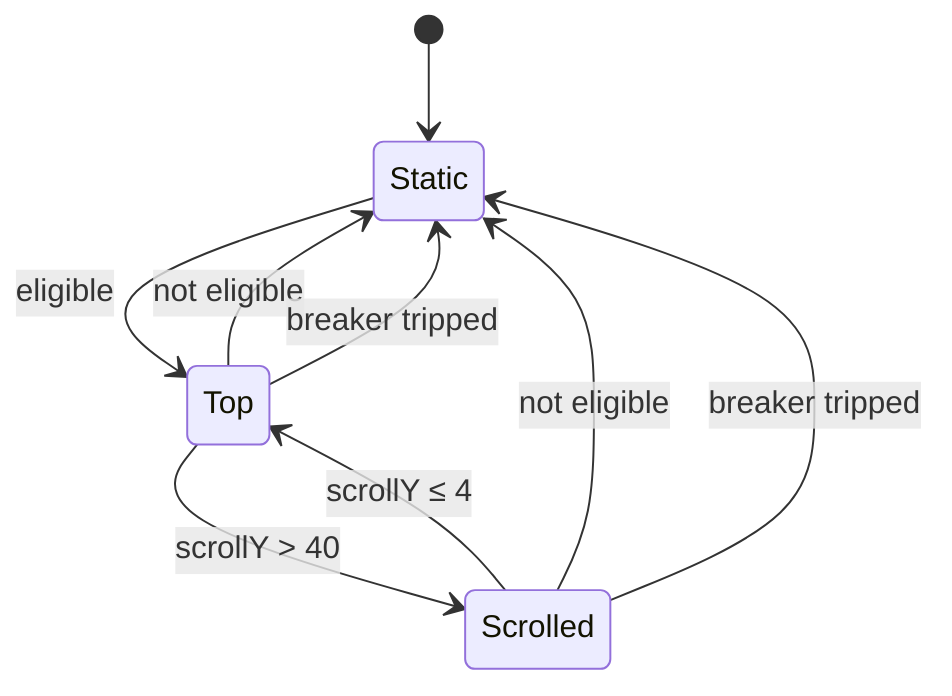

# Design: UI Redesign — "Consola"

Everything below is transcribed from the live prototype (`mockup/`). Numbers marked **[src]** come
from the embedded `renderVals()` / event handlers of the Claude Design artboards (authoritative);
**[measured]** from computed styles / bounding boxes in the running prototype; **[derived]** are
calculations made for this document; **[amend]** are accessibility amendments to the mockup
(see `proposal.md` § Accessibility amendments). Screenshots of each state: `mockup/states/`.

## 1. Technical approach

- **Tokens as CSS custom properties.** `:root` carries the light tokens, `.dark` (the class the
  app already toggles; `@custom-variant dark (&:where(.dark, .dark *))`) overrides them. Tokens are
  registered in Tailwind 4 via `@theme inline` so components use utilities (`bg-surface`,
  `text-muted`, `border-line`, `rounded-card`, `font-mono`) — no inline styles, no `ngStyle`.
- **Surface recipes** (`glass-chrome`, `glass-card`, `glass-field`) are `@utility` classes in
  `src/styles.css` composed from tokens, including the **legibility floor** layer (§ 5); components
  never restate gradients or shadows.
- **Theme switching is unchanged**: `ThemeService` keeps `light | dark | auto` and the `dark` class.
  Only the scrim (`body:after`) changes colour/opacity.
- **Scroll state** is one boolean signal (`scrolled`) owned by a small `ScrollStateService`
  (`providedIn: 'root'`) fed by a passive `scroll` listener on `window` (RxJS `fromEvent` is fine — a
  genuine browser event stream). It is consumed by the shell, clock, and search components.
- **Whole-page scroll.** The page (window) scrolls; the dock and configurator header are
  `position: sticky`. Today's fixed header/footer + inner scroller is removed.
- **No behavioural change.** Services (`AppService`, `SearchService`, `CategoryService`,
  `SettingsService`, `AppStatusService`, `ConfiguratorStore`, …) are untouched; components keep their
  inputs/outputs. Template and style changes, plus the new service above.

### Component map

| Today                                             | After                                                                                             |
| ------------------------------------------------- | ------------------------------------------------------------------------------------------------- |
| `app-shell` fixed header/footer + inner scroll    | Page scroll; dock wrapper (sticky); footer in flow                                                |
| `app-header`                                      | Chip (logo + title + description) + two 44 px icon buttons (configurator link, theme)             |
| `app-clock` (`text-5xl` + date line)              | Split clock widget + weekday & date pills; compact row when scrolled                              |
| `app-finder` + `app-search-engine-selector`       | One glass search bar; engine selector button on the left, listbox popover; clear + submit buttons |
| `app-categories` (fit-width pill nav)             | Full-width glass tab bar, underline selection                                                     |
| `app-card` (vertical, centred, scale 1.05)        | Horizontal head (icon tile · name · status pill), description, mono tag chips; lift 4 px on hover |
| `app-footer` (fixed text)                         | Glass footer bar in flow: `Powered by Mando vX` · `Created with ♡ by Rack&Host YEAR`              |
| `app-toast` (own light/dark colours, translucent) | Card recipe with floor, token accents, valid container role                                       |
| `configurator-page` single column                 | Sticky header band + heading panel + sticky scroll-spy side nav + numbered section cards          |
| `collection-editor` rows                          | Compact rows (index, icon, name/URL, category tag, flags, reorder/edit/delete), inline editor     |
| checkboxes (settings, flags)                      | `role="switch"` toggles (44 × 26 track); Theme and Date position as segmented controls            |

## 2. Decisions

| #   | Decision                                                                                                                                                                                                                                                                                                                                                                                                  | Rationale                                                                                                                                                                                                                                        | Alternative rejected                                                                           |
| --- | --------------------------------------------------------------------------------------------------------------------------------------------------------------------------------------------------------------------------------------------------------------------------------------------------------------------------------------------------------------------------------------------------------- | ------------------------------------------------------------------------------------------------------------------------------------------------------------------------------------------------------------------------------------------------ | ---------------------------------------------------------------------------------------------- |
| D1  | Tokens = CSS variables + Tailwind `@theme inline`                                                                                                                                                                                                                                                                                                                                                         | Matches Tailwind 4 setup already in `styles.css`; one source for both themes; testable by reading the variables                                                                                                                                  | Inline styles per component (what the mockup does) — violates repo rules and duplicates values |
| D2  | Keep `.dark` class strategy                                                                                                                                                                                                                                                                                                                                                                               | `ThemeService` and every spec rely on it                                                                                                                                                                                                         | `prefers-color-scheme` only — breaks the manual toggle                                         |
| D3  | **Self-host fonts** with `@fontsource-variable/nunito` and `@fontsource/ibm-plex-mono` (Latin + Latin-Extended `woff2`; IBM Plex Mono weights 400/500/600; Nunito Variable covers 400–800; families `'Nunito Variable'` and `'IBM Plex Mono'`) — **decided and installed (D-c)**; wiring (`@font-face` for the two subsets only, so other scripts are not copied to `dist`) happens in the implementation | Self-hosted product, may run offline/air-gapped; no third-party request per page view                                                                                                                                                            | Google Fonts `<link>` as in the mockup                                                         |
| D4  | Scroll hysteresis as in the prototype (enter `scrollY > 40`, leave `scrollY ≤ 4` **[src]**) **plus** capacity gating (D14)                                                                                                                                                                                                                                                                                | Hysteresis alone does **not** prevent the loop when the page is short: compaction shrinks the document, the browser clamps `scrollY`, the state flips back, the dock grows, and it repeats (simulated: 40 flips in 40 steps with 2 rows of apps) | Hysteresis only; a single threshold                                                            |
| D5  | Minute digits via `-webkit-text-stroke` + accent fill                                                                                                                                                                                                                                                                                                                                                     | Supported by all evergreen browsers; matches mockup                                                                                                                                                                                              | SVG text / background-clip — heavier, harder to size responsively                              |
| D6  | Initials icons keep using `IconService.generateInitialsIcon` (SVG ``) inside the 44 px tile                                                                                                                                                                                                                                                                                                          | The mockup's `mark/tint/ink` tiles are the same feature rendered with Plex Mono; no schema/service change warranted                                                                                                                              | Re-implement initials as text tiles with a per-app palette                                     |
| D7  | **Static colon** (no blink) **[amend]**                                                                                                                                                                                                                                                                                                                                                                   | Satisfies WCAG 2.2.2 without a pause control; the pulse is decorative                                                                                                                                                                            | Pulse guarded by `prefers-reduced-motion` — still fails 2.2.2 for everyone else                |
| D8  | Whole-page scroll, sticky dock, footer in flow **[src]**                                                                                                                                                                                                                                                                                                                                                  | It is what the prototype does; the compact-on-scroll states depend on `window` scroll                                                                                                                                                            | Keep inner scroll container                                                                    |
| D9  | `scroll-padding-top` = live dock height (CSS variable set from a `ResizeObserver`)                                                                                                                                                                                                                                                                                                                        | Focused controls and anchor jumps never sit under the dock (WCAG 2.4.11)                                                                                                                                                                         | Hard-coded offsets (the prototype hard-codes `104`/`96` for the configurator nav)              |
| D10 | Opaque fallback surfaces under `@supports not (backdrop-filter: blur(1px))`                                                                                                                                                                                                                                                                                                                               | Blur on 10–20 elements is expensive on low-power GPUs; keeps text legible when unsupported                                                                                                                                                       | Assume support                                                                                 |
| D11 | **Legibility floor** layer under every glass surface **[amend]**                                                                                                                                                                                                                                                                                                                                          | Contrast must hold over any user background image, not only the sample photos                                                                                                                                                                    | Rely on the scrim alone — fails AA for dark photos in light theme                              |
| D12 | Two-tone focus ring **[amend]**                                                                                                                                                                                                                                                                                                                                                                           | Visible on any backdrop in both themes                                                                                                                                                                                                           | Single accent ring — 1.5 : 1 against some light-theme backdrops                                |
| D13 | Dock sticks only on tall-enough viewports **[amend]**                                                                                                                                                                                                                                                                                                                                                     | Dock is 286 px when scrolled (desktop): ≥ 40 % of a 700 px viewport                                                                                                                                                                              | Always sticky                                                                                  |
| D14 | **State-independent eligibility**: compaction is allowed only if the page still scrolls after the dock shrinks (`R = (docTop − viewport) − Δ ≥ 80`, dropped at `R < 56`), computed from the _Top-layout_ document height                                                                                                                                                                                  | Removes the feedback between the state and its own trigger: eligibility does not change when the state flips, so the system has a fixed point                                                                                                    | Compare `scrollY` after the flip and revert — still flickers once                              |
| D15 | `scrollbar-gutter: stable` on the root and `overflow-anchor: none` on the page container                                                                                                                                                                                                                                                                                                                  | A scrollbar appearing/disappearing changes `vw`-based `clamp()` sizes (clock, padding) and thus heights → second loop source; scroll anchoring would adjust `scrollTop` behind our back                                                          | Default scrollbar / anchoring                                                                  |
| D16 | **Circuit breaker**: more than 4 state changes within 2 s latch the dock in _Static_ until the viewport size or the content height changes                                                                                                                                                                                                                                                                | Safety net against any unforeseen loop (font load, zoom, extension CSS)                                                                                                                                                                          | None — an infinite animation loop is the worst failure mode here                               |

## 3. Design tokens

### 3.1 Colour **[src]**

| Token                                                        | Dark                                                                      | Light                                                                     |
| ------------------------------------------------------------ | ------------------------------------------------------------------------- | ------------------------------------------------------------------------- |
| `--bg`                                                       | `#0D0F11`                                                                 | `#F3F1EC`                                                                 |
| `--scrim`                                                    | `rgba(13,15,17,0.6)`                                                      | `rgba(243,241,236,0.2)`                                                   |
| `--surface`                                                  | `#15181C`                                                                 | `#FFFFFF`                                                                 |
| `--surface-2`                                                | `rgba(255,255,255,0.07)`                                                  | `rgba(22,24,27,0.06)`                                                     |
| `--line`                                                     | `rgba(255,255,255,0.10)`                                                  | `rgba(22,24,27,0.10)`                                                     |
| `--line-strong`                                              | `#353B44`                                                                 | `#CEC8BC`                                                                 |
| `--text`                                                     | `#EDEBE6`                                                                 | `#16181B`                                                                 |
| `--muted`                                                    | `#B3B8C0`                                                                 | `#474C54`                                                                 |
| `--accent`                                                   | `#F0B04A`                                                                 | `#9A5B00`                                                                 |
| `--accent-ink`                                               | `#17110A`                                                                 | `#FFFFFF`                                                                 |
| `--up` / `--up-bg`                                           | `#46D396` / `rgba(70,211,150,0.12)`                                       | `#11724A` / `rgba(17,114,74,0.10)`                                        |
| `--down` / `--down-bg`                                       | `#FF8A73` / `rgba(255,138,115,0.14)`                                      | `#B8341F` / `rgba(184,52,31,0.10)`                                        |
| `--clock-ink` (hours)                                        | `#EDEBE6`                                                                 | `#383E44`                                                                 |
| `--minute-fill` **[amend]**                                  | `rgba(240,176,74,0.65)` (mockup 0.42)                                     | `rgba(154,91,0,0.75)` (mockup 0.32)                                       |
| `--pill-line` / `--pill-bg`                                  | `rgba(255,255,255,0.5)` / `rgba(255,255,255,0.04)`                        | `rgba(22,24,27,0.4)` / `rgba(255,255,255,0.45)`                           |
| `--card` / `--card-line`                                     | `rgba(21,24,28,0.62)` / `rgba(255,255,255,0.10)`                          | `rgba(255,255,255,0.72)` / `rgba(255,255,255,0.8)`                        |
| `--card-hover` / `--card-line-hover`                         | `rgba(32,36,43,0.76)` / `rgba(255,255,255,0.24)`                          | `rgba(255,255,255,0.9)` / `rgba(255,255,255,1)`                           |
| `--chrome`                                                   | `linear-gradient(180deg, rgba(34,38,45,0.58), rgba(18,21,25,0.40))`       | `linear-gradient(180deg, rgba(255,255,255,0.62), rgba(255,255,255,0.42))` |
| `--chrome-line`                                              | `rgba(255,255,255,0.14)`                                                  | `rgba(255,255,255,0.75)`                                                  |
| `--icon-tile`                                                | `linear-gradient(180deg, rgba(255,255,255,0.10), rgba(255,255,255,0.04))` | `linear-gradient(180deg, rgba(255,255,255,0.95), rgba(255,255,255,0.70))` |
| `--menu` (engine popover)                                    | `rgba(21,24,28,0.92)`                                                     | `rgba(255,255,255,0.90)`                                                  |
| `--field` (configurator inputs) **[measured]**               | `rgba(8,10,12,0.55)`                                                      | `rgba(255,255,255,0.7)` (derived)                                         |
| `--field-border` **[amend]**                                 | `rgba(255,255,255,0.45)` (mockup 0.10)                                    | `rgba(22,24,27,0.55)` (derived)                                           |
| `--floor-bar` / `--floor-card` / `--floor-clock` **[amend]** | `0.15` / `0.35` / `0.15`                                                  | `0.55` / `0.80` / `0.90`                                                  |
| `--focus` / `--focus-halo` **[amend]**                       | `#F0B04A` / `rgba(13,15,17,0.9)`                                          | `#16181B` / `rgba(255,255,255,0.9)`                                       |

The floor colour is `--surface`. Band when scrolled **[src]**: `rgba(13,15,17,0.62)` (dark) /
`rgba(243,241,236,0.55)` (light), `backdrop-filter: blur(22px) saturate(160%)`, shadow dark
`0 1px 0 rgba(255,255,255,0.08), 0 16px 32px -16px rgba(0,0,0,0.6)`, light
`0 1px 0 rgba(255,255,255,0.7), 0 16px 32px -16px rgba(30,36,50,0.25)`.

Configurator active nav item **[src]**: 2 px left line `--accent`, background `rgba(240,176,74,0.10)`
(dark; light derived from `--accent` at 0.10), text `--text`; inactive text `--muted`. Inline editor row
**[src]**: background `rgba(240,176,74,0.06)`, ring `inset 0 0 0 1px rgba(240,176,74,0.28)`, radius 14,
padding `12px 20px`; active edit button background `rgba(240,176,74,0.14)`, icon `--accent`.

### 3.2 Glass **[src]**

| Token                 | Dark                                                                                                                                           | Light                                                                                                                                             |
| --------------------- | ---------------------------------------------------------------------------------------------------------------------------------------------- | ------------------------------------------------------------------------------------------------------------------------------------------------- |
| `--glass`             | `blur(24px) saturate(160%)`                                                                                                                    | `blur(24px) saturate(180%)`                                                                                                                       |
| `--card-glass`        | `blur(16px) saturate(150%)`                                                                                                                    | `blur(16px) saturate(160%)`                                                                                                                       |
| `--glass-shadow`      | `inset 0 1px 0 rgba(255,255,255,.18), inset 0 -1px 0 rgba(255,255,255,.04), inset 0 0 18px rgba(255,255,255,.04), 0 10px 32px rgba(0,0,0,.35)` | `inset 0 1px 0 rgba(255,255,255,.95), inset 0 -1px 0 rgba(255,255,255,.35), inset 0 0 18px rgba(255,255,255,.25), 0 10px 32px rgba(30,36,50,.14)` |
| `--card-shadow`       | `inset 0 1px 0 rgba(255,255,255,.08), 0 4px 18px rgba(0,0,0,.25)`                                                                              | `inset 0 1px 0 rgba(255,255,255,.9), 0 4px 18px rgba(30,36,50,.08)`                                                                               |
| `--card-shadow-hover` | `inset 0 1px 0 rgba(255,255,255,.16), 0 0 0 1px rgba(240,176,74,.18), 0 16px 36px rgba(0,0,0,.42)`                                             | `inset 0 1px 0 rgba(255,255,255,1), 0 0 0 1px rgba(154,91,0,.16), 0 16px 36px rgba(30,36,50,.18)`                                                 |
| `--icon-shadow`       | `inset 0 1px 0 rgba(255,255,255,.12)`                                                                                                          | `inset 0 1px 0 #fff, 0 2px 6px rgba(30,36,50,.08)`                                                                                                |
| `--bar-radius`        | `16px`                                                                                                                                         | `12px`                                                                                                                                            |

### 3.3 Typography

| Role                 | Family / weight                                              | Size (px)                              | Notes **[src/measured]**                                          |
| -------------------- | ------------------------------------------------------------ | -------------------------------------- | ----------------------------------------------------------------- |
| UI text              | Nunito 400/500/600/700/800, fallback `system-ui, sans-serif` | 14 body, 13 secondary                  | Default `font-family` of the app                                  |
| Header title (`h1`)  | Nunito 600                                                   | 18, tracking −0.18                     | Description 13 muted                                              |
| Clock digits         | Nunito 800                                                   | `clamp(88px, 11vw, 150px)`; compact 40 | tracking −0.03 em (−4.5 px @150)                                  |
| Weekday / date pills | IBM Plex Mono 600, uppercase                                 | 12, tracking 0.16 em                   | Pill padding 5 × 11, radius 999                                   |
| Category tab         | Nunito 500                                                   | 15                                     | Inactive `--muted`, active `--text` + 2 px accent underline       |
| Card title           | Nunito 600                                                   | 16                                     | Description 14 muted                                              |
| Tag chip             | IBM Plex Mono 400                                            | 12                                     | 24 px high, radius 6, padding 0 8, 1 px `--line`                  |
| Status pill          | IBM Plex Mono 500                                            | 11, tracking 0.08 em                   | 22 px high, radius 6, padding 0 8, dot + label                    |
| Footer               | IBM Plex Mono 400                                            | 12                                     | Muted; links `--text` underlined                                  |
| Empty state title    | Nunito 600                                                   | 20                                     | Body 14 muted                                                     |
| Configurator `h1`    | Nunito 600                                                   | 40, tracking −0.8                      | Eyebrow `DASHBOARD SETUP`: Plex Mono 12, accent, tracking 0.16 em |
| Configurator `h2`    | Nunito 600                                                   | 19                                     | Step index: Plex Mono 13 accent                                   |
| Field label / value  | Nunito 500 / Plex Mono for paths, URLs, format strings       | 13 / 14                                | Inputs 44 high, radius 10                                         |

### 3.4 Radii, spacing, layout **[measured]**

| Item           | Value                                                                                                                                                                                                      |
| -------------- | ---------------------------------------------------------------------------------------------------------------------------------------------------------------------------------------------------------- |
| Page container | max-width 1360 incl. `clamp(16px, 4vw, 40px)` inline padding → 1280 content at 1440                                                                                                                        |
| Header         | padding 24 / 0 (12 when scrolled); bottom 1 px `rgba(255,255,255,.1)` (dark) / `rgba(22,24,27,.1)` (light)                                                                                                 |
| Header chip    | radius 18, gap 14, padding 6 16 6 6 **[src `chipPad`]**                                                                                                                                                    |
| Header buttons | 44 × 44, radius 12, gap 8                                                                                                                                                                                  |
| Clock section  | padding `clamp(32px,6vw,64px) 0 clamp(20px,3vw,32px)` (12 / 10 scrolled)                                                                                                                                   |
| Clock widget   | radius 26, padding `clamp(20px,2.5vw,28px) clamp(28px,4vw,48px) clamp(18px,2.2vw,24px)`                                                                                                                    |
| Search bar     | height 60 (44 scrolled idle, 52 expanded), radius 16, padding 0 8 0 6; engine button 44 high radius 10; submit button 44 × 44 accent                                                                       |
| Tab bar        | height 45, radius `--bar-radius`, padding 0 18, gap 28 (12 when compact/scrolled)                                                                                                                          |
| Card grid      | gap 14; 5 columns at 1440 (244.8 px each); 1 column at 390 (358 px)                                                                                                                                        |
| Card           | padding 18, radius 16, inner gap 12; icon tile 44 × 44 radius 12                                                                                                                                           |
| Footer bar     | height 45, padding 14 18, gap 16, radius `--bar-radius`, glass chrome                                                                                                                                      |
| Dock (desktop) | container `[40, 0, 1360]`, padding `0 40px 16px`: **584 px** high at top → **≈ 278 px** scrolled (286 with the search expanded); `z-index: 20`                                                             |
| Dock (mobile)  | `[0, 0, 390, 113]`: padding-top 12, search 44, gap 12, tabs 45 (bleeds to the container edges)                                                                                                             |
| Configurator   | header sticky `z-index: 30`; side nav 240 wide, sticky `top: 104` (≤ 900: `top: 96`); content column 1008 at 1440; section card radius 18, padding 28; inputs 44 high radius 10; toggle 44 × 26 radius 999 |

### 3.5 Background

`#app-background` keeps the user's `lightBackgroundImage` / `darkBackgroundImage` (prototype: `filter:
saturate(0.85)`, `object-fit: cover`, position `50% 50%`), covered by the `--scrim` layer (dark 0.6,
light 0.2). Today's `body:after` (white 0.1 / black 0.6) is replaced by the tinted scrim. Overlay
opacities are constants, **not** user settings.

## 4. Behaviour

### 4.1 Scroll behaviour **[src] + [measured] + [amend]**

#### State machine

Three states, owned by `ScrollStateService` (window scroll; shared by dashboard and configurator):

- **Static** — dock/header **not sticky**, top-state look, no band, no compaction. Used when the page
  cannot meaningfully scroll after compaction, when the viewport is too small (D13), or after the
  circuit breaker trips.
- **Top** — eligible, `scrollY ≤ 4` (or not yet past 40): sticky, transparent, large layout.
- **Scrolled** — eligible, past the threshold: sticky, band, compact layout.

#### Eligibility (capacity gating, D14)

Let `Δ` be the height the dock loses when compacting (measured: ≈ 306 px desktop dashboard, ≈ 16 px
mobile dock, ≈ 10 px configurator header; `Δ = H_top − H_scrolled`, where `H_top` is the last
measured Top-layout height and `H_scrolled` the token constant `--dock-height-compact`), and
`docTop` the document height _as it would be in the Top layout_
(`docTop = scrollHeight + (state is Scrolled ? Δ : 0)`). The remaining scroll capacity after
compaction is

`R = (docTop − innerHeight) − Δ`

Eligible when `R ≥ 80` and the viewport guards of D13 pass; once eligible it stays so until `R < 56`
(24 px dead band). Because `R` is derived from the Top-layout height, flipping between Top and Scrolled
never changes it: there is no feedback between the state and its own eligibility. When _Scrolled_,
the document is `Δ` shorter, so after the flip `maxScrollY ≥ R + 0 ≥ 56 > 40`: the browser never clamps
`scrollY` below the 40 px threshold and the state cannot be knocked back by the flip itself.

Worked example (desktop dock, viewport 900 px, Δ = 306 px, 5 columns of 171 px cards, 14 px gap):

| App rows | `docTop` (px) | Capacity (`docTop − 900`) | `R`   | Result                           |
| -------- | ------------- | ------------------------- | ----- | -------------------------------- |
| 1        | 894           | −6                        | −312  | Static — nothing to scroll       |
| 2        | 1079          | 179                       | −127  | Static (naive scheme loops here) |
| 3        | 1264          | 364                       | 58    | Static                           |
| 4        | 1449          | 549                       | 243   | Eligible: Top ⇄ Scrolled         |
| ≥ 5      | ≥ 1634        | ≥ 734                     | ≥ 428 | Eligible                         |

Simulated closed loop (scroll intent 200 px held, browser clamping `scrollY` to the document):
hysteresis-only gives 40 state changes in 40 steps at 2 rows (infinite); gated gives 0 changes at
1–3 rows and exactly 1 at ≥ 4 rows.

#### Rules that keep it loop-free

1. State changes are decided in one place, from `scrollY` and the eligibility values — never from a
   `ResizeObserver` callback synchronously (observer callbacks only _record_ heights and schedule a
   `requestAnimationFrame` re-evaluation, avoiding "ResizeObserver loop" errors and same-frame feedback).
2. `scrollbar-gutter: stable` on `html` (D15) so the scrollbar appearing/disappearing cannot change
   `vw`-driven sizes; `overflow-anchor: none` on the page container.
3. Dwell: after any state change, further changes are ignored until the transition has finished
   (≥ 400 ms, or immediately under reduced motion).
4. Circuit breaker (D16): more than 4 changes in 2 s ⇒ **Static** until the viewport size or the
   content height changes; logged once through `LoggerService` (diagnostics only, no notification).
5. Eligibility is re-evaluated when app count/filter, viewport size, fonts or the dock height change
   — e.g. typing a search that leaves one row moves Top/Scrolled → Static in one step, once.

#### Dashboard, desktop

One sticky container — the _dock_ — wraps header + clock + search + tabs
(`position: sticky; top: 0; z-index: 20`). Cards scroll underneath it.

| Aspect                    | Static / Top                                     | Scrolled                                                                                                                                             |
| ------------------------- | ------------------------------------------------ | ---------------------------------------------------------------------------------------------------------------------------------------------------- |
| Dock position             | Static: normal flow · Top: sticky                | sticky                                                                                                                                               |
| Dock background / blur    | transparent / none                               | band + `blur(22px) saturate(160%)` + edge shadow (§ 3.1)                                                                                             |
| Dock height               | 584 px                                           | ≈ 278 px (286 expanded)                                                                                                                              |
| Header                    | padding 24                                       | padding 12 (height 81)                                                                                                                               |
| Clock                     | column, 150 px digits, widget padding clamp(...) | row: digits 40 px (hour stroke 1 px, minute stroke 1.2 px), pills inline after a 1 px divider (`--line` 12 %), widget padding `10px 22px`, height 80 |
| Search height / max-width | 60 / 1360                                        | 44 / 440 (centred), or 52 / 1360 while _expanded_                                                                                                    |
| Search _expanded_         | —                                                | input focused **or** query non-empty **or** engine menu open                                                                                         |
| Tab gap                   | 28                                               | 12                                                                                                                                                   |

#### Dashboard, mobile (`compact`, ≤ 600 px)

The header and clock scroll away normally. The dock is **search + tabs** only (113 px **[measured]**:
padding-top 12, search 44, gap 12, tabs 45), sticky at `top: 0`, bleeding to the edges with
`margin: 0 calc(-1 * clamp(16px,4vw,40px))` and padding `12px clamp(16px,4vw,40px) 0`; same
band/blur/shadow as the desktop dock when _Scrolled_. Clock does not shrink; tab gap 12. The search
height changes 60 → 44 px (Δ = 16 px), so the same eligibility rule applies with that Δ.

#### Viewport guards **[amend]**

The desktop dock is sticky only at `min-height: 720px`; the mobile dock only at `min-height: 500px`;
otherwise **Static**. `scroll-padding-top` equals the live dock height (D9).

#### Configurator

The header is sticky (`z-index: 30`): _Top_ padding 24 and transparent; _Scrolled_ padding 14, band +
blur + shadow (same recipes); Δ ≈ 10 px with the same eligibility rule (it is practically always
eligible; Static if the draft is shorter than the viewport). The side nav is sticky at `top: 104px`.
_Scroll-spy_: the active section is the last of `start, metadata, settings, categories, applications,
bookmarks, export` whose top ≤ 140 px (≤ 900 px viewport: 200 px); when the page is scrolled to the
bottom (`innerHeight + scrollY ≥ scrollHeight − 4`) the last section is active. At ≤ 900 px the layout
is one column and the side nav becomes a horizontal chip bar (sticky `top: 96`, padding 6, radius 16):
items in a row without wrapping, native horizontal scroll with hidden scrollbar, vertical wheel maps to
horizontal scroll, edge fades via mask (20 px left / 28 px right, only on an overflowing side), and the
active item is auto-centred on each active-section change (smooth; instant under reduced motion; only the bar scrolls, never the page; suspended while the user drags/wheels the bar and for 1 s after; never triggered by the bar's own scroll events). The scroll-spy threshold must be ≥ the live sticky-stack height + 24 px and sections use the same `scroll-margin-top`, so clicking a chip makes that chip active. At ≤ 600 px the `Back to dashboard` label is visually
hidden (icon only). The theme button toggles the theme exactly as on the dashboard (the prototype's
button is not wired; the behaviour is the dashboard's).

Transitions **[src]**: 0.25–0.4 s on `padding`, `font-size`, `max-width`, `height`, `opacity`,
`background`, `box-shadow`, `transform`, `border-color`. All disabled under `prefers-reduced-motion:
reduce`.

### 4.2 Clock

- `HH:mm` from the existing 1 s timer; hours `--clock-ink` solid; colon `--accent` solid and
  **static** (D7) with `padding: 0 0.06em`; minutes `--minute-fill` fill + `2px solid --accent` stroke
  (`-webkit-text-stroke`).
- Weekday pill (accent background, `--accent-ink` text, `EEEE` uppercase) + date pill (`--pill-bg`,
  1 px `--pill-line`, `--text`). The weekday pill is always the weekday (`EEEE`); the date pill renders the `dateFormat` setting uppercase (owner decision — the mockup's `13 OCTOBER` is sample output of a `d MMMM` format); `datePosition`
  `top|bottom` keeps working (pills above/below the digits); `showDate: false` hides both pills.
- `showSeconds: true` → seconds readout (owner decision; not drawn in the mockup, so defined here):
  IBM Plex Mono 600, `max(14px, 0.18em)` of the digit size, `--muted`, tabular figures, aligned to the
  digit baseline after the minutes, `aria-hidden` (no per-second announcements). In the compact
  scrolled row it stays at 14 px. Contrast on the widget ≥ 4.5 : 1 (token test).
- One accessible name for the widget; digits and seconds are **not** an `aria-live` region.

### 4.3 Search

- One bar: engine selector button (`Apps ⌄` / engine name, `aria-label="Select search engine"`,
  `aria-expanded`) · text input (`id` stable, accessible name `Search applications`) · when a query
  exists a clear `×` button and an accent **submit** button (44 × 44, arrow icon, `--accent` background,
  `--accent-ink` icon).
- Placeholder **[src]**: `Search your applications…` for the Apps scope, `Search on <engine>…` otherwise.
- Engine popover: `role="listbox"` with `role="option"` items, background `--menu`; options are
  `Your apps` (glyph tile `~`) followed by the enabled engines (sample: `Startpage` `S`, `YouTube`
  `Y`); selected option has `--surface-2` background and a check icon; Escape/blur closes.
- While a query exists the category tabs are dimmed (opacity 0.45), non-selected, and disabled.

### 4.4 Tabs, cards, status

- Tabs: `nav` + `button[aria-pressed]`; selected = `--text` + 2 px `--accent` underline, others
  `--muted`. Horizontal overflow scrolls (no wrapping); last item clipped at the edge on mobile.
- Card is the single activator (`a`) with the mockup's accessible name: `<name>` or `<name>, online` / `<name>, offline` when monitored (owner decision: follow the redesign; replaces `Open <name>, currently up|down`).
- Status pill only for apps with `healthCheck` and a result: `● UP` (`--up` on `--up-bg`) / `● DOWN`
  (`--down` on `--down-bg`). Text label is the non-colour cue (`app-status-check` delta).
- Hover **[src]**: `translateY(-4px)`, icon `scale(1.08)`, `--card-hover` background, hover border and
  shadow tokens. Keyboard focus applies the same elevation plus the focus ring.
- Setting flags: `showDescriptions`, `showLabels`; cards in a row stretch to the tallest.

### 4.5 Empty / loading / error

- Empty state (from the capture; exact paddings to be confirmed against the DOM): container with **dashed** 1 px `--line-strong` border, radius 16,
  padding 32, `--surface` background, magnifier-minus line icon (24 px), title `No applications found`
  (20/600) and the existing helper copy (14 muted). No emoji.
- Loading and error surfaces are not drawn: they adopt the card recipe and existing copy.
- **Toast** (not drawn; defined here, spec `design-system` § Notification toasts): card recipe with floor, radius 16, 6 px accent strip on the left (decorative; the level text label carries the meaning), level label in Plex Mono 11 px uppercase, message 14 px, dismiss button 32 px. Accents: error `--down`, success `--up`, warning `--accent`, info `--text`. Container `role="group"` labelled `Notifications` (fixes the baseline `aria-prohibited-attr`). Behaviour unchanged.

### 4.6 Configurator controls (from the captures; exact paddings/radii to be confirmed against the DOM at implementation)

- Heading panel: glass chrome, radius 26, padding 28; eyebrow, `h1`, one-line description.
- Starting-point cards: three options (icon · title · caption); selected = accent border + tinted
  background; `Import local YAML` has a dashed border; mounted card caption is the mounted path in mono.
- Validation panel: `--down-bg` tint, 1 px `--down` border, title `Fix the following errors`
  (14/600 `--down`), list items in Plex Mono with the field path.
- Segmented controls for **Theme** (`Light | Dark | Auto`) and **Date position** (`Top | Bottom`):
  radio-group semantics, selected segment `--surface-2` background.
- Switch tiles: label left, switch right, tile with 1 px `--line`; grouped under `Display options`
  and `Search engines` (`Google`, `DuckDuckGo`, `Startpage`, `YouTube`).
- Collection rows: index (mono), icon tile (apps/bookmarks), name + URL/id (mono), category tag
  (mono chip), flags text (`health · new tab`, mono), then up / down / edit / delete icon buttons
  (delete in `--down`).
- Export: `Copy YAML`, `Download YAML` (secondary), `Save` (accent); token panel with `Write token`
  password field, help text naming `CONFIG_WRITE_TOKEN`, `Save token & save` (accent) / `Cancel`.

## 5. Accessibility

- **Focus ring [amend]:** `outline: 2px solid var(--focus); outline-offset: 2px; box-shadow: 0 0 0
2px var(--focus-halo)` on every focusable element in both themes.
- Dock never covers focus (D9, D13). Tab order = visual order. Landmarks: `header`, `main`,
  `nav[aria-label="Categories"]`, `footer`.
- Switches: `role="switch"`, `aria-checked`, visible label, ≥ 24 px target. Segmented controls:
  radio group with a group label. Side nav: `aria-current="true"` on the active item.
- Colour is never the only cue (status text, selected tab underline + text colour, pill text).
- Colon is static; all remaining motion honours `prefers-reduced-motion`.

### Contrast method

Backdrop under the scrim is unknown (user image), so every pair is evaluated against the two
extremes **black and white** under the scrim, through the real surface stack (floor layer + glass
gradient at its top and bottom stops); the worst case is reported. Blur averages colours so it
cannot leave this range. Thresholds: 4.5 : 1 text, 3 : 1 large text (clock ≥ 24 px) and UI
boundaries. This is exactly what the token test (§ 6) computes.

### Contrast results **[derived]** (with the amended tokens, worst case)

| Pair                                                        | Dark  | Light | Required | Result                                            |
| ----------------------------------------------------------- | ----- | ----- | -------- | ------------------------------------------------- |
| `--text` on card                                            | 11.53 | 16.09 | 4.5      | pass                                              |
| `--muted` on card (descriptions, tags)                      | 6.89  | 7.82  | 4.5      | pass                                              |
| `UP` on its pill                                            | 5.65  | 4.69  | 4.5      | pass                                              |
| `DOWN` on its pill                                          | 4.67  | 4.61  | 4.5      | pass                                              |
| `--text` on bar (header, search, tabs, footer)              | 8.29  | 10.74 | 4.5      | pass                                              |
| `--muted` on bar (inactive tab, footer text)                | 4.95  | 5.22  | 4.5      | pass                                              |
| `--accent` underline on bar                                 | 5.18  | 3.28  | 3        | pass                                              |
| Clock hours on widget                                       | 8.29  | 9.75  | 3        | pass                                              |
| Colon + minute stroke (`--accent`) on widget                | 5.18  | 4.89  | 3        | pass                                              |
| **Minute digits — fill only** (amended)                     | 3.03  | 3.02  | 3        | pass                                              |
| Date pill text on pill                                      | 7.37  | 16.81 | 4.5      | pass                                              |
| Weekday pill ink on accent                                  | 9.83  | 5.43  | 4.5      | pass                                              |
| Focus ring vs adjacent surface                              | 7.20  | 16.09 | 3        | pass                                              |
| Field border vs card and vs field (WCAG 1.4.11) **[amend]** | 3.52  | 3.66  | 3        | pass (mockup border at 10 %: 1.05 / 1.14 — fails) |
| Hovered card `--muted` text                                 | 7.08  | 8.34  | 4.5      | pass                                              |

Before amendments (mockup tokens, worst case): minute fill-only 2.02 (dark) / 1.16 (light); light
accent on widget 1.51; light `--muted` on bar 2.41; light UP/DOWN pills 3.08 / 3.03; dark DOWN 4.00.
Disabled tabs during search (opacity 0.45) are an inactive component, exempt from 1.4.3.

## 6. Verification

| Layer       | What                                                                                                                                                                                                                                                                                                                                                                                                                                                                                                                                                                                                                                                                                                                                                                                                                             |
| ----------- | -------------------------------------------------------------------------------------------------------------------------------------------------------------------------------------------------------------------------------------------------------------------------------------------------------------------------------------------------------------------------------------------------------------------------------------------------------------------------------------------------------------------------------------------------------------------------------------------------------------------------------------------------------------------------------------------------------------------------------------------------------------------------------------------------------------------------------- |
| Unit        | `design-tokens.spec.ts`: parse the token CSS, composite each pair of § 5 over black and white backdrops through the surface stack, assert thresholds in both themes; `ScrollStateService` hysteresis (41 → scrolled, 5 stays, 4 → top); **closed-loop fixed-point test**: simulate the document (height depends on the state, `scrollY` clamped to it) for 1…12 app rows, viewports 500–1200 px high, Δ ∈ {10, 16, 306}, random scroll intents and random content/viewport changes — assert at most 1 state change per input and that holding the input constant converges within 2 steps (the naive scheme fails this at 2 rows); circuit-breaker latch; eligibility dead band (R = 80 on, 56 off); clock formatting for pills, `datePosition`, `showSeconds`, `showDate`; static colon; configurator scroll-spy selection rule |
| Component   | Existing component specs updated for new markup: status pill text, card aria-label unchanged, tab `aria-pressed`, switch `role`/`aria-checked`, listbox/option semantics, side-nav `aria-current`                                                                                                                                                                                                                                                                                                                                                                                                                                                                                                                                                                                                                                |
| a11y        | axe on `/` and `/configure`, dark + light, 1440 and 390 px, with the dock in both states; keyboard walk header → search → tabs → cards → footer; focus under the dock                                                                                                                                                                                                                                                                                                                                                                                                                                                                                                                                                                                                                                                            |
| Smoke       | Browser run with 1, 2, 3, 4 and 10 rows of apps at 900 px and at 390 × 844: scroll in steps, count class/attribute changes of the dock with a `MutationObserver` (≤ 1 per user scroll direction), no animation running at rest (`document.getAnimations()` empty after 1 s)                                                                                                                                                                                                                                                                                                                                                                                                                                                                                                                                                      |
| Visual      | Render the states of `mockup/states/*` with the same sample data; compare; owner sign-off on declared amendments                                                                                                                                                                                                                                                                                                                                                                                                                                                                                                                                                                                                                                                                                                                 |
| Performance | Lighthouse desktop before/after; scroll jank with 20 cards and blur on a low-end device                                                                                                                                                                                                                                                                                                                                                                                                                                                                                                                                                                                                                                                                                                                                          |
| Build       | `ng build`, `ng lint`, `ng test`, `npm run format:check`                                                                                                                                                                                                                                                                                                                                                                                                                                                                                                                                                                                                                                                                                                                                                                         |

## 7. Gaps in the mockup (assumptions taken)

| Gap                                                                                       | Assumption in the specs                                                                                                   |
| ----------------------------------------------------------------------------------------- | ------------------------------------------------------------------------------------------------------------------------- |
| Configurator has **only the dark theme** (its theme button is not wired in the prototype) | Light configurator derived from the dashboard's light tokens; the theme button works as on the dashboard (owner decision) |
| Tablet breakpoints of the dashboard                                                       | Keep today's ladder: 1 col, `md` 2, `lg` 3, `xl` `itemsPerRow`                                                            |
| `compact` is a prop of the prototype, not a breakpoint                                    | Mobile layout applies at ≤ 600 px (the only mobile breakpoint the mockup defines)                                         |
| Loading, error and light-theme engine/empty states beyond the screenshots                 | Same recipes; owner reviews after implementation                                                                          |
| Header logo asset                                                                         | Keep `img/mando.png`                                                                                                      |
| Sample data uses `itemsPerRow: 5`; schema default is 4                                    | Layout driven by the setting, not hard-coded                                                                              |
| Date pill omits the year; seconds not drawn                                               | Resolved: date pill follows `dateFormat`; seconds readout defined in § 4.2                                                |
