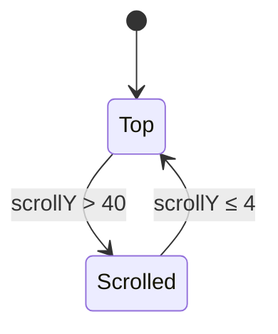

# Design: UI Redesign — "Consola"

Everything below is transcribed from the mockup (`mockup/`). Numbers marked **[src]** come from the
embedded `renderVals()` of the Claude Design artboards (authoritative); numbers marked **[measured]**
come from computed styles of the 1440 × 1000 and 390 × 844 renders; **[derived]** are calculations
made for this document.

## 1. Technical approach

- **Tokens as CSS custom properties.** `:root` carries the light tokens, `.dark` (the class the
  app already toggles; `@custom-variant dark (&:where(.dark, .dark *))`) overrides them. Tokens are
  registered in Tailwind 4 via `@theme inline` so components use utilities (`bg-surface`,
  `text-muted`, `border-line`, `rounded-card`, `font-mono`) — no inline styles, no `ngStyle`.
- **Surface recipes** (`glass-chrome`, `glass-card`, `glass-field`) are `@utility` classes in
  `src/styles.css` composed from tokens; components never restate gradients or shadows.
- **Theme switching is unchanged**: `ThemeService` keeps `light | dark | auto` and the `dark` class.
  Only the scrim (the `body:after` rule) changes colour/opacity.
- **Scroll state** is one boolean signal (`scrolled`) owned by a small `ScrollStateService`
  (`providedIn: 'root'`) fed by a passive `scroll` listener (RxJS `fromEvent` is acceptable here — a
  genuine browser event stream). It is consumed by the shell, clock, and search components.
- **No behavioural change.** Services (`AppService`, `SearchService`, `CategoryService`,
  `SettingsService`, `AppStatusService`, `ConfiguratorStore`, …) are untouched; components keep their
  inputs/outputs. Template and style changes only, plus the new service above.

### Component map

| Today                                          | After                                                                              |
| ---------------------------------------------- | ---------------------------------------------------------------------------------- |
| `app-shell` fixed header/footer + inner scroll | Page-level scroll; sticky header band; footer in flow (D8)                         |
| `app-header`                                   | Chip (logo + title + description) + two 44 px icon buttons; band when `scrolled`   |
| `app-clock` (`text-5xl` + date line)           | Split clock widget (hours solid / colon / minutes outlined) + weekday & date pills |
| `app-finder` + `app-search-engine-selector`    | One glass search bar; engine selector button inside the bar's left edge            |
| `app-categories` (fit-width pill nav)          | Full-width glass tab bar with underline selection                                  |
| `app-card` (vertical, centred, scales)         | Horizontal head (icon tile · name · status pill), description, mono tag chips      |
| `app-footer` (fixed text)                      | Glass footer bar: `Powered by Mando vX` · `Created with ♡ by Rack&Host YEAR`       |
| `configurator-page` single column              | Header + numbered side nav (sticky) + section cards                                |
| `collection-editor` rows                       | Compact rows with category tag, reorder/edit/delete icon buttons, inline editor    |
| checkboxes (settings, flags)                   | `role="switch"` toggles (44 × 26 track)                                            |

## 2. Decisions

| #   | Decision                                                                                                                                    | Rationale                                                                                                                                                                                         | Alternative rejected                                                                                                                        |
| --- | ------------------------------------------------------------------------------------------------------------------------------------------- | ------------------------------------------------------------------------------------------------------------------------------------------------------------------------------------------------- | ------------------------------------------------------------------------------------------------------------------------------------------- |
| D1  | Tokens = CSS variables + Tailwind `@theme inline`                                                                                           | Matches Tailwind 4 setup already in `styles.css`; one source for both themes; testable by reading the variables                                                                                   | Inline styles per component (what the mockup does) — violates repo rules (`ngStyle`/style bindings only when dynamic) and duplicates values |
| D2  | Keep `.dark` class strategy                                                                                                                 | `ThemeService` and every spec rely on it                                                                                                                                                          | `prefers-color-scheme` only — would break the manual toggle                                                                                 |
| D3  | **Self-host fonts** with `@fontsource-variable/nunito` and `@fontsource/ibm-plex-mono` (weights 400/500/600)                                | Self-hosted product, may run offline/air-gapped; no third-party request on every page view; no FOIT from a cross-origin stylesheet. **Adds two dev dependencies → requires owner approval (Q1).** | Google Fonts `<link>` as in the mockup — simplest, but leaks viewer IPs to a third party and fails offline                                  |
| D4  | Scroll hysteresis exactly as the mockup: enter `scrollY > 40`, leave `scrollY ≤ 4` **[src]**                                                | Prevents flicker at the threshold                                                                                                                                                                 | Single threshold                                                                                                                            |
| D5  | Minute digits via `-webkit-text-stroke` + transparent-ish fill                                                                              | Supported by all evergreen browsers; matches mockup                                                                                                                                               | SVG text / background-clip — heavier, harder to size responsively                                                                           |
| D6  | Initials icons keep using `IconService.generateInitialsIcon` (SVG ``) inside the 44 px tile                                            | The mockup's `mark/tint/ink` tiles are the same feature (`icon.type: initials`) rendered with Plex Mono and hand-picked colours; no schema or service change is warranted                         | Re-implement initials as a text tile with per-app palette — new behaviour, new colour-contrast burden                                       |
| D7  | Colon pulse (opacity 1 ↔ 0.3 every second, **[src]** `d.getSeconds() % 2`) only when `prefers-reduced-motion: no-preference`; `aria-hidden` | Honest to the mockup; guards the worst case. WCAG 2.2.2 (Level A) still applies to auto-blinking content > 5 s → **Q5 recommends making it static**                                               | Always pulse — fails reduced-motion users                                                                                                   |
| D8  | Whole-page scroll; sticky header; footer in flow                                                                                            | The mockup's scrolled state, sticky bands and 3 500 px configurator canvas only make sense with page scroll (**Q6**)                                                                              | Keep inner scroll container — would require re-deriving every sticky offset                                                                 |
| D9  | `scroll-padding-top` = live header height (CSS variable set from `ResizeObserver`)                                                          | Keeps anchor jumps and focused controls from sitting under the sticky band (WCAG 2.4.11)                                                                                                          | Hard-coded 104 px (the configurator nav's `top`) — breaks when the band shrinks/grows                                                       |
| D10 | Opaque fallback surfaces under `@supports not (backdrop-filter: blur(1px))`                                                                 | Blur on 10–20 elements is expensive on low-power GPUs; keeps text legible when unsupported                                                                                                        | Assume support                                                                                                                              |

## 3. Design tokens

### 3.1 Colour **[src]**

| Token                                                 | Dark                                                                      | Light                                                                     |
| ----------------------------------------------------- | ------------------------------------------------------------------------- | ------------------------------------------------------------------------- |
| `--bg`                                                | `#0D0F11`                                                                 | `#F3F1EC`                                                                 |
| `--scrim`                                             | `rgba(13,15,17,0.6)`                                                      | `rgba(243,241,236,0.2)`                                                   |
| `--surface`                                           | `#15181C`                                                                 | `#FFFFFF`                                                                 |
| `--surface-2`                                         | `rgba(255,255,255,0.07)`                                                  | `rgba(22,24,27,0.06)`                                                     |
| `--line`                                              | `rgba(255,255,255,0.10)`                                                  | `rgba(22,24,27,0.10)`                                                     |
| `--line-strong`                                       | `#353B44`                                                                 | `#CEC8BC`                                                                 |
| `--text`                                              | `#EDEBE6`                                                                 | `#16181B`                                                                 |
| `--muted`                                             | `#B3B8C0`                                                                 | `#474C54`                                                                 |
| `--accent`                                            | `#F0B04A`                                                                 | `#9A5B00`                                                                 |
| `--accent-ink`                                        | `#17110A`                                                                 | `#FFFFFF`                                                                 |
| `--up` / `--up-bg`                                    | `#46D396` / `rgba(70,211,150,0.12)`                                       | `#11724A` / `rgba(17,114,74,0.10)`                                        |
| `--down` / `--down-bg`                                | `#FF8A73` / `rgba(255,138,115,0.14)`                                      | `#B8341F` / `rgba(184,52,31,0.10)`                                        |
| `--clock-ink` (hours)                                 | `#EDEBE6`                                                                 | `#383E44`                                                                 |
| `--minute-fill`                                       | `rgba(240,176,74,0.42)`                                                   | `rgba(154,91,0,0.32)`                                                     |
| `--pill-line` / `--pill-bg`                           | `rgba(255,255,255,0.5)` / `rgba(255,255,255,0.04)`                        | `rgba(22,24,27,0.4)` / `rgba(255,255,255,0.45)`                           |
| `--card` / `--card-line`                              | `rgba(21,24,28,0.62)` / `rgba(255,255,255,0.10)`                          | `rgba(255,255,255,0.72)` / `rgba(255,255,255,0.8)`                        |
| `--card-hover` / `--card-line-hover`                  | `rgba(32,36,43,0.76)` / `rgba(255,255,255,0.24)`                          | `rgba(255,255,255,0.9)` / `rgba(255,255,255,1)`                           |
| `--chrome`                                            | `linear-gradient(180deg, rgba(34,38,45,0.58), rgba(18,21,25,0.40))`       | `linear-gradient(180deg, rgba(255,255,255,0.62), rgba(255,255,255,0.42))` |
| `--chrome-line`                                       | `rgba(255,255,255,0.14)`                                                  | `rgba(255,255,255,0.75)`                                                  |
| `--icon-tile`                                         | `linear-gradient(180deg, rgba(255,255,255,0.10), rgba(255,255,255,0.04))` | `linear-gradient(180deg, rgba(255,255,255,0.95), rgba(255,255,255,0.70))` |
| `--menu` (engine dropdown)                            | `rgba(21,24,28,0.92)`                                                     | `rgba(255,255,255,0.90)`                                                  |
| Field background (configurator inputs) **[measured]** | `rgba(8,10,12,0.55)`                                                      | derive from light-theme configurator once drawn (Q-gap, see §7)           |

Scrolled band **[src]**: `rgba(13,15,17,0.62)` (dark) / `rgba(243,241,236,0.55)` (light), backdrop
`blur(22px) saturate(160%)`, shadow dark `0 1px 0 rgba(255,255,255,0.08), 0 16px 32px -16px rgba(0,0,0,0.6)`,
light `0 1px 0 rgba(255,255,255,0.7), 0 16px 32px -16px rgba(30,36,50,0.25)`.

### 3.2 Glass **[src]**

| Token                 | Dark                                                                                                                                           | Light                                                                                                                                             |
| --------------------- | ---------------------------------------------------------------------------------------------------------------------------------------------- | ------------------------------------------------------------------------------------------------------------------------------------------------- |
| `--glass`             | `blur(24px) saturate(160%)`                                                                                                                    | `blur(24px) saturate(180%)`                                                                                                                       |
| `--card-glass`        | `blur(16px) saturate(150%)`                                                                                                                    | `blur(16px) saturate(160%)`                                                                                                                       |
| `--glass-shadow`      | `inset 0 1px 0 rgba(255,255,255,.18), inset 0 -1px 0 rgba(255,255,255,.04), inset 0 0 18px rgba(255,255,255,.04), 0 10px 32px rgba(0,0,0,.35)` | `inset 0 1px 0 rgba(255,255,255,.95), inset 0 -1px 0 rgba(255,255,255,.35), inset 0 0 18px rgba(255,255,255,.25), 0 10px 32px rgba(30,36,50,.14)` |
| `--card-shadow`       | `inset 0 1px 0 rgba(255,255,255,.08), 0 4px 18px rgba(0,0,0,.25)`                                                                              | `inset 0 1px 0 rgba(255,255,255,.9), 0 4px 18px rgba(30,36,50,.08)`                                                                               |
| `--card-shadow-hover` | `inset 0 1px 0 rgba(255,255,255,.16), 0 0 0 1px rgba(240,176,74,.18), 0 16px 36px rgba(0,0,0,.42)`                                             | `inset 0 1px 0 rgba(255,255,255,1), 0 0 0 1px rgba(154,91,0,.16), 0 16px 36px rgba(30,36,50,.18)`                                                 |
| `--icon-shadow`       | `inset 0 1px 0 rgba(255,255,255,.12)`                                                                                                          | `inset 0 1px 0 #fff, 0 2px 6px rgba(30,36,50,.08)`                                                                                                |
| `--bar-radius`        | `16px`                                                                                                                                         | `12px`                                                                                                                                            |

### 3.3 Typography

| Role                 | Family / weight                                              | Size (px)                             | Notes **[src/measured]**                                    |
| -------------------- | ------------------------------------------------------------ | ------------------------------------- | ----------------------------------------------------------- |
| UI text              | Nunito 400/500/600/700/800, fallback `system-ui, sans-serif` | 14 body, 13 secondary                 | Default `font-family` of the app                            |
| Header title (`h1`)  | Nunito 600                                                   | 18, tracking −0.18                    | Description 13 muted                                        |
| Clock digits         | Nunito 800                                                   | `clamp(88px, 11vw, 150px)`; shrunk 40 | tracking −0.03 em (−4.5 px @150)                            |
| Weekday / date pills | IBM Plex Mono 600, uppercase                                 | 12, tracking 0.16 em                  | Pill padding 5 × 11, radius 999                             |
| Category tab         | Nunito 500                                                   | 15                                    | Inactive `--muted`, active `--text` + 2 px accent underline |
| Card title           | Nunito 600                                                   | 16                                    | Description 14 muted                                        |
| Tag chip             | IBM Plex Mono 400                                            | 12                                    | 24 px high, radius 6, padding 0 8, 1 px `--line`            |
| Status pill          | IBM Plex Mono 500                                            | 11, tracking 0.08 em                  | 22 px high, radius 6, padding 0 8, dot + label              |
| Footer               | IBM Plex Mono 400                                            | 12                                    | Muted; links `--text` underlined                            |
| Configurator `h1`    | Nunito 600                                                   | 40, tracking −0.8                     | Eyebrow: Plex Mono accent, uppercase                        |
| Configurator `h2`    | Nunito 600                                                   | 19                                    | Step index: Plex Mono 13 accent                             |

### 3.4 Radii, spacing, layout **[measured]**

| Item           | Value                                                                                                                                                      |
| -------------- | ---------------------------------------------------------------------------------------------------------------------------------------------------------- |
| Page container | max-width 1360 incl. `clamp(16px, 4vw, 40px)` inline padding → 1280 content at 1440                                                                        |
| Header         | padding 24 / 0 (12 when scrolled); bottom 1 px `rgba(255,255,255,.1)` (dark) / `rgba(22,24,27,.1)` (light)                                                 |
| Header chip    | radius 18, gap 14, padding 6 16 6 6 **[src `chipPad`]**                                                                                                    |
| Header buttons | 44 × 44, radius 12, gap 8                                                                                                                                  |
| Clock section  | padding `clamp(32px,6vw,64px) 0 clamp(20px,3vw,32px)` (12 / 10 scrolled)                                                                                   |
| Clock widget   | radius 26, padding `clamp(20px,2.5vw,28px) clamp(28px,4vw,48px) clamp(18px,2.2vw,24px)`                                                                    |
| Search bar     | height 60 (44 scrolled idle, 52 scrolled+expanded), radius 16, padding 0 8 0 6, engine button 44 high radius 10                                            |
| Tab bar        | height 45, radius `--bar-radius`, padding 0 18, gap 28 (12 when compact/scrolled)                                                                          |
| Card grid      | gap 14; 5 columns at 1440 (244.8 px each); 1 column at 390 (358 px)                                                                                        |
| Card           | padding 18, radius 16, inner gap 12; icon tile 44 × 44 radius 12                                                                                           |
| Footer bar     | padding 14 18, gap 16, radius `--bar-radius`, glass chrome                                                                                                 |
| Configurator   | side nav 240 wide, sticky `top: 104`; content column 1008 at 1440; section card radius 18, padding 28; inputs 44 high radius 10; toggle 44 × 26 radius 999 |

### 3.5 Background

`#app-background` keeps the user's `lightBackgroundImage` / `darkBackgroundImage` (mockup: `filter:
saturate(0.85)`, `object-fit: cover`, position `50% 50%`), covered by the `--scrim` layer (dark 0.6,
light 0.2). Today's `body:after` (white 0.1 / black 0.6) is replaced by the tinted scrim.
Overlay opacities are constants, **not** user settings (the mockup's `overlayDark/overlayLight` props
are design-time knobs).

## 4. Behaviour

### 4.1 Scroll state machine **[src]**

| Aspect (desktop, ≥ mobile breakpoint) | Top                     | Scrolled                                                                                               |
| ------------------------------------- | ----------------------- | ------------------------------------------------------------------------------------------------------ |
| Header                                | static look, padding 24 | `position: sticky; top: 0`, band + blur 22, padding 12                                                 |
| Clock                                 | column, 150 px digits   | row: digits 40 px (strokes 1 / 1.2 px), date pills inline left of a 1 px divider, widget padding 10 22 |
| Search height / max-width             | 60 / 1360               | 44 / 440, or 52 / 1360 while _expanded_                                                                |
| Search _expanded_                     | —                       | input focused **or** query non-empty **or** engine menu open                                           |
| Tab gap                               | 28                      | 12                                                                                                     |

Mobile / `compact` layout **[src]**: header is **not** sticky; the **search bar** is sticky with the
band (`0 calc(-1 * clamp(16px,4vw,40px))` bleed, padding `12px clamp(16px,4vw,40px) 0`); the clock
does not shrink; tab gap is 12.

Transitions: 0.25–0.4 s on `padding`, `font-size`, `max-width`, `height`, `opacity`, `background`,
`box-shadow`, `transform`, `border-color`. All disabled under `prefers-reduced-motion: reduce`.

### 4.2 Clock

- `HH:mm` from the existing 1 s timer; hours `--clock-ink` solid; colon `--accent` solid with
  `padding: 0 0.06em`; minutes `--minute-fill` fill + `2px solid --accent` stroke (`-webkit-text-stroke`).
- Weekday pill (accent background, `--accent-ink` text, `EEEE` uppercase) + date pill (`--pill-bg`,
  1 px `--pill-line`, `--text`). Date text driven by `dateFormat` setting (Q2); `datePosition`
  `top|bottom` keeps working (pills above/below the digits); `showDate: false` hides both pills.
- `showSeconds: true` → small seconds readout (Q3). Not drawn in the mockup; proposed: Plex Mono 600,
  `0.18×` digits size, baseline aligned after minutes, `--muted`.
- Whole widget exposes one accessible name (`role="timer"` is not used — it implies live updates);
  digits and seconds are not an `aria-live` region.

### 4.3 Search

- One bar: engine selector button (`Apps ⌄` / engine name) · text input · clear and submit buttons
  when a query exists. Placeholder: `Search your applications…` for the _Apps_ scope, `Search on
<engine>…` otherwise **[src]** — equals today's `inputPlaceholder` logic apart from the wording of the
  first string.
- While a query exists the category tabs are dimmed (opacity 0.45), non-selected, and disabled —
  as today.
- Engine menu: popover under the button, `--menu` background, selected item `--surface-2`.

### 4.4 Tabs, cards, status

- Tabs: `role` unchanged (`nav` + `button[aria-pressed]`); selected = `--text` + 2 px `--accent`
  underline, others `--muted`. Horizontal overflow scrolls (no wrapping); no visible scrollbar,
  last item clipped at the edge as drawn on mobile.
- Card is the single activator (`button`) with today's `aria-label` (`Open <name>[, currently up|down]`).
- Status pill appears only for apps with `healthCheck`: `● UP` (`--up` on `--up-bg`) / `● DOWN`
  (`--down` on `--down-bg`) — **text label is the non-colour cue** (requires the `app-status-check` delta).
- Hover **[src]**: `translateY(-4px)`, icon `scale(1.08)`, `--card-hover` background, hover border and
  shadow tokens. Focus-visible uses the global focus ring (§5) and the same elevation.
- Setting flags: `showDescriptions`, `showLabels` hide the description / tag row; card height follows
  content; cards in a row stretch to the tallest.

### 4.5 Empty / loading / error

Not drawn in the mockup. They adopt the glass card recipe, 16/600 title, 14 muted body, no emoji,
and keep today's copy and conditions; reviewed visually by the owner (Q-gap, §7).

## 5. Accessibility

- Focus ring: `outline: 2px solid var(--accent)`, offset 2 px, on every focusable element in both
  themes (replaces `rgba(255,255,255,0.5)`, which is invisible on the light theme).
- Sticky bands never cover focus (D9). Tab order = visual order. Landmarks: `header`, `main`,
  `nav[aria-label="Categories"]`, `footer`.
- Switches: `role="switch"`, `aria-checked`, visible label, ≥ 24 px target (44 × 26 track).
- Colour is never the only cue (status text, selected tab underline, pill text).
- Everything honours `prefers-reduced-motion`; `prefers-contrast: more` is not specified by the
  mockup and is out of scope.

### Contrast **[derived]** (alpha composited over the page colour; ratio, WCAG relative luminance)

| Pair                               | Dark     | Light    | Requirement | Result   |
| ---------------------------------- | -------- | -------- | ----------- | -------- |
| `--text` on card                   | 15.38    | 17.21    | ≥ 4.5       | pass     |
| `--muted` on card                  | 9.19     | 8.36     | ≥ 4.5       | pass     |
| `UP` on its badge                  | 7.71     | 5.76     | ≥ 4.5       | pass     |
| `DOWN` on card                     | 7.97     | 5.73     | ≥ 4.5       | pass     |
| Weekday pill ink on accent         | 9.83     | 5.43     | ≥ 4.5       | pass     |
| Accent as text/underline on page   | —        | 4.81     | ≥ 4.5 / 3   | pass     |
| Inactive tab (`--muted`) on bar    | 8.57     | —        | ≥ 4.5       | pass     |
| Clock hours on widget              | —        | 10.2     | ≥ 3 (large) | pass     |
| **Minute digits — fill only**      | **2.63** | **1.56** | ≥ 3 (large) | **fail** |
| Minute digits — 2 px accent stroke | 8.96     | 5.11     | ≥ 3 (large) | pass     |

The fill-only failure is intentional design (outlined digits). Requirement: the **stroke** is the
perceivable boundary and MUST meet 3:1; the stroke width MUST NOT drop below 1 px (scrolled state uses
1.2 px at 40 px digits). A manual check is required in both themes because axe does not evaluate
`-webkit-text-stroke`.

## 6. Verification

| Layer       | What                                                                                                                                                                                                                                       |
| ----------- | ------------------------------------------------------------------------------------------------------------------------------------------------------------------------------------------------------------------------------------------ |
| Unit        | `design-tokens.spec.ts`: parse token CSS, assert every pair in §5 meets its ratio in both themes; `ScrollStateService` hysteresis (41 → scrolled, 5 stays, 4 → top); clock formatting for pills, `datePosition`, `showSeconds`, `showDate` |
| Component   | Existing component specs updated for new markup: status pill text, card aria-label unchanged, tab `aria-pressed`, switch `role`/`aria-checked`, configurator side-nav anchors                                                              |
| a11y        | axe (existing harness) on `/` and `/configure`, dark + light; keyboard walk through header → search → tabs → cards → footer                                                                                                                |
| Visual      | Render at 1440 × 1000 (dark, light), 390 × 844 (dark) and the scrolled state; compare against `mockup/*.png` with the same sample data; owner sign-off                                                                                     |
| Performance | Lighthouse desktop before/after; scroll jank check with 20 cards and backdrop blur on a low-end device                                                                                                                                     |
| Build       | `ng build`, `ng lint`, `ng test`, `npm run format:check`                                                                                                                                                                                   |

## 7. Gaps in the mockup (decisions needed or assumptions taken)

| Gap                                                                                                                 | Assumption in the specs                                                                                                   |
| ------------------------------------------------------------------------------------------------------------------- | ------------------------------------------------------------------------------------------------------------------------- |
| Light theme of the configurator, tablet breakpoints, empty/loading/error states, toasts, engine menu in light theme | Derive from the same tokens; owner reviews after implementation                                                           |
| Dashboard 391–1439 px behaviour                                                                                     | Keep today's ladder: 1 col, `md` 2, `lg` 3, `xl` `itemsPerRow`                                                            |
| Mobile `compact` is a prop in the mockup, not a breakpoint; the threshold is not defined                            | `compact` applies at ≤ 600 px, the only breakpoint the mockup defines (configurator `max-width: 600px`); owner to confirm |
| Header logo asset (broken in the render)                                                                            | Keep `img/mando.png`                                                                                                      |
| Sample data uses `itemsPerRow: 5`; schema default is 4                                                              | Layout driven by the setting, not hard-coded                                                                              |
| `clockStyle: classic`, accent colour options, overlay sliders                                                       | Not shipped (Q4)                                                                                                          |
| Clock explorations E–J                                                                                              | Not shipped                                                                                                               |
